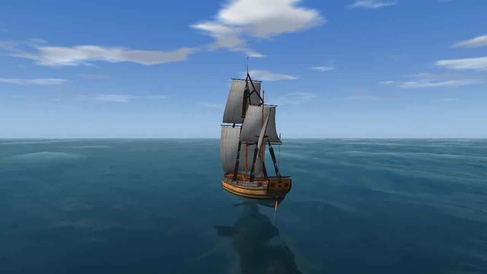
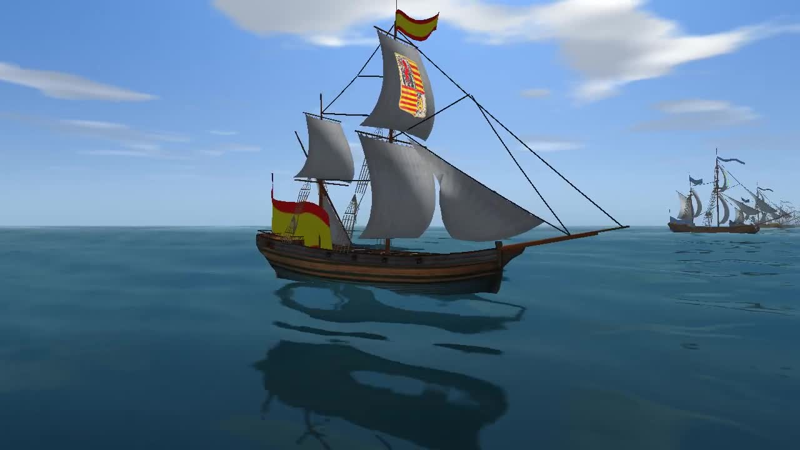
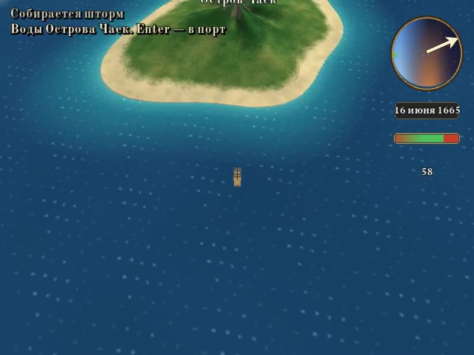
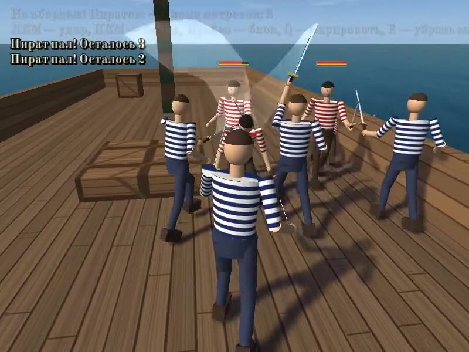
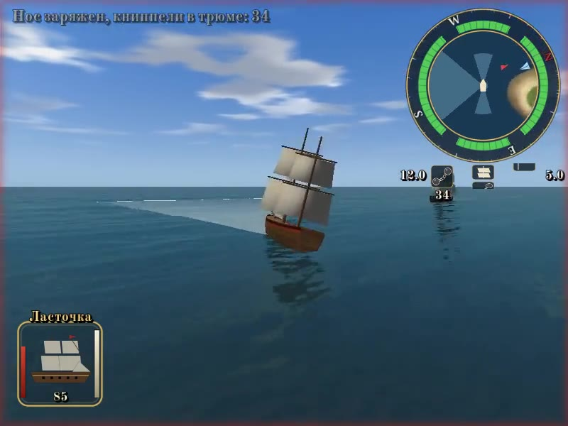
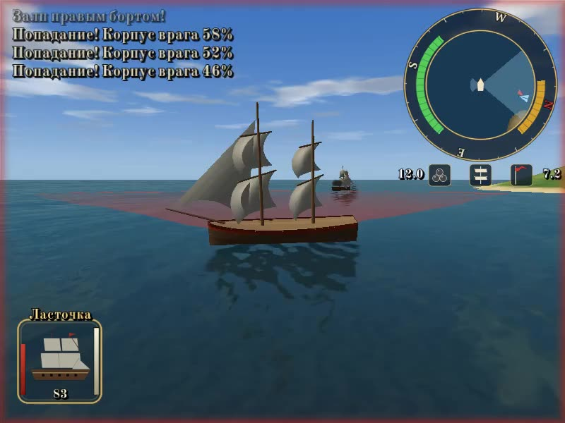
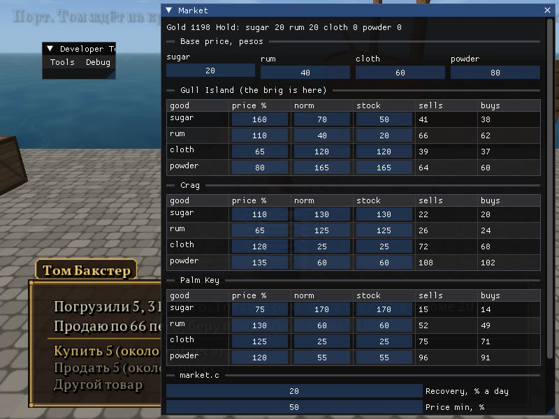
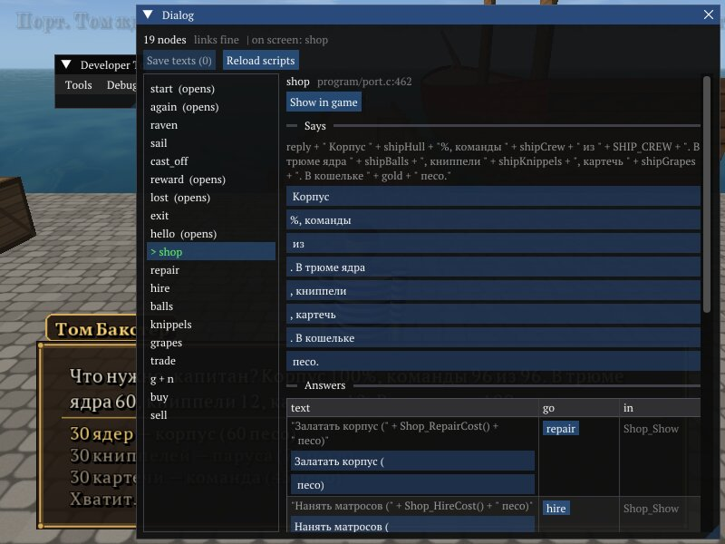
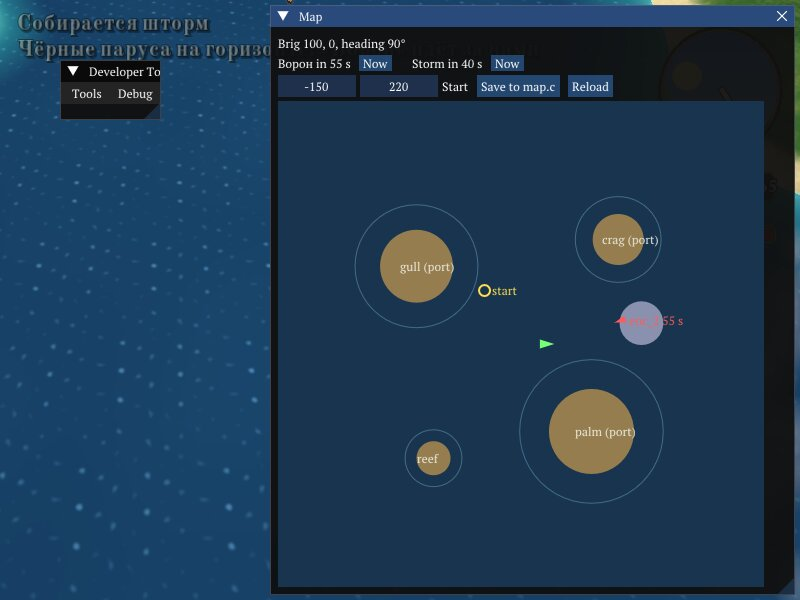

# Corsairs Remake

Game content for a remaster of *Corsairs* on [Storm Engine](https://github.com/POMXARK/storm-engine).
The engine lives in the `engine/` submodule; this repository holds only the game: scripts, interface
and text configs, and the assets built from free sources (see [CREDITS.md](CREDITS.md)). The built assets
are committed, so the game runs right after clone; `run.sh` rebuilds them (the output is the same).

```
engine/   Storm Engine fork (submodule, branch miniaudio-sound)
assets/   downloaded free assets: fonts, the menu background
game/     game folder the engine runs in: engine.ini, program/ (menu.c — the menu and the scene switch,
          world.c — the sea, sky, sound and game state, port.c — the port and Tom, map.c — the world map, sea.c — the sea battle,
          deck.c — the boarding, trade.c — the markets and the hold, market.c — their prices and stocks),
          resource/ (ini, built textures, models, sounds)
tools/    fetch_assets.sh — downloads free assets; make_assets.py — converts them to .tx textures and fonts.ini;
          make_port.py — the port: quay, pier, sailors, dialog window; make_deck.py — the deck of «Ворон»,
          the fencers and the saber for the boarding.
economy/  the economy simulator: sim.py — the markets and the voyages, tune.py — Optuna writes market.c,
          replay.py — checks a game log against the model, report.py — docs/ECONOMY.md
          The other assets come from the generators of the engine demos (engine/demos/*/make_*.py)
```

## The original game on Storm Engine (`pdm-game/`)

The port of the original *Corsairs* (PDM 1.061) itself: its ships, islands, characters, dialogs and
story from an installed copy of the game, converted on the first run (nothing of it is committed). The
original has no scripts, its logic is C++ in DLLs, so `pdm-game/program/` plays their role on the
converted data. The stages and their status: [docs/port-plan.md](docs/port-plan.md).

```bash
PDM=<Sea Dogs install dir> pdm-game/run.sh <path to built engine executable>
```

Building on Linux and Windows (Debug, Release, a package to play), the repositories and branches, how
the game is made from the installed original, the controls: [docs/build.md](docs/build.md). One script
does it all from a menu: `pdm-game/game.sh` (Linux), `pdm-game/game.bat` (Windows).

[](pdm-game/media/pdm-game.mp4)
[](pdm-game/media/pdm-review.mp4)

The fleet review (`SCENE=review`, 2× speed): every hull of `Ships.idf` on the water in turn, masts and
yards as model nodes, deck guns, the flag of its nation at the mastheads and the stern, the arms on the
sails.

## Video

[](media/voyage.mp4)

The voyage (105 s, with sound): «Новая игра» → the brig casts off onto the world map, clouds over the
archipelago, the date under the clock → black sails: «Ворон» comes after her and catches her → the sea
battle (cut short in this run, the win is set by the script) → back on the map the brig makes for Gull
Island → Enter in its waters → the port.

[](media/boarding.mp4)

Boarding (65 s, with sound): Tom sends the captain out → «Ворон» comes out of the cannonade wrecked and the
grapnels go over (the gunnery is cut from this run) → on his deck the captain and three sailors cut down four
pirates → back in the port Tom pays the bounty and the prize money, 800 pesos.

[](media/third-slice.mp4)

The third slice (117 s, with sound): in the port Tom sells chain shot and grape shot → out to sea → two
broadsides of chain shot tear the enemy's sails and slow her down, grape shot thins her crew, round shot
sinks her (the battle is shown 4× faster) → back in the port Tom pays the 500 pesos → the carpenters patch
the hull for the next fight.

[](media/second-slice.mp4)

A scripted run of the whole slice (91 s, with sound): «Новая игра» → the captain runs along the pier to
Tom → the conversation → out to sea → a fair battle, both brigs led by the AI, the camera on «Ворон» and
the aim zone on the water (shown 4× faster: broadsides until «Ворон» sinks) → back in the
port Tom pays 500 pesos → F5 → the menu → «Загрузить» brings the game back with 600 pesos.

## Run (Linux)

```bash
git clone --recursive https://github.com/POMXARK/corsairs-remake.git
# build the engine from engine/ (Linux build notes are in the engine fork), then:
./run.sh <path to built engine executable> [--editor]
```

## Run (Windows 11)

Visual Studio 2022 or 2019 (Build Tools are enough) with «Desktop development with C++» and Python 3.
In any PowerShell (or double-click the `.bat` files):

```powershell
git clone --recursive https://github.com/POMXARK/corsairs-remake.git
cd corsairs-remake
.\build.bat             # the engine with the game's editor windows: engine\build\default\Debug\engine.exe
.\run.bat --editor
```

`build.bat` (`build.ps1` → `engine/build.ps1`) enters the developer shell of Visual Studio, puts the
Scripts folder of Python in PATH, installs by pip what is missing (Conan 2.12.2, Ninja ≥ 1.11, CMake 3.31,
Pillow, numpy), makes the Conan profile and builds the preset; the first build downloads several GB of Conan
packages. By hand it is, in Developer PowerShell for VS:

```powershell
git clone --recursive https://github.com/POMXARK/corsairs-remake.git
cd corsairs-remake\engine
cmake --preset=default "-DSTORM_EXTRA_MODULES=$PWD\..\editor"
cmake --build --preset=debug
cd ..
.\run.bat --editor
```

The engine is the `engine/` submodule: no separate clone of storm-engine is needed. `run.bat` (or
`run.ps1`) does what `run.sh` does and takes `engine\build\default\Debug\engine.exe` when no engine path
is given; double-clicking it works too.
The common errors of the first build (Conan not found, Visual Studio 2019 picked, `cmake` from the wrong
folder) are in `engine/docs/ru/08-linux-build.md`, section 11. Not tested on Windows yet.

Arrow keys / mouse select a menu item, Enter or a click activates it, Escape or «Выход» quits.

«Новая игра» starts in the port: the captain walks along the quay to the old boatswain Tom at the end of
the pier. Tom tells about the pirate brig «Ворон» guarding the bay, and «Отдать швартовы!» takes the
captain's brig «Ласточка» out to the world map (the engine demo `worldmap`): an archipelago of four islands,
ports on Остров Чаек, Утёс and Пальмовый, the clock with the sky of the day, the wind, clouds and storms. Out at sea «Ворон» comes
after the brig, and when he catches her (or Enter is pressed with him near) the battle begins; a storm takes
2% of the hull every 5 s, down to 20%. Enter in the waters of an island with a port goes ashore. The battle is built from the engine demos: the AI brig «Ворон» near
an island, with the HUD — navigator (compass, wind, speeds, the enemy on the minimap), the ship panel
(hull, sails, crew, cannon reload) and the battle log in Russian. After a win Enter returns to the
map, and the brig sails back to the port (no «Ворон» comes until Tom has paid); after a loss she is
towed straight to the port of Остров Чаек. Tom pays 500 pesos for the first «Ворон» sunk: two broadsides sink her even when only half of the balls hit.
The pirates learn: every next «Ворон», up to the fifth, takes a hit 20% better, carries 12 pirates
more, takes 0.5% more of our hull with a hit, reloads 5% faster and sails 0.4 kn faster, and the governor pays 250 pesos
more for him (the fifth and the later ones — 1500).

The brig keeps her state between the battles: the hull, the crew and the charges in the hold (a
broadside takes 6; with none of the loaded kind left the guns are silent). There are three charges,
switched with 1 / 2 / 3, the HUD icon shows the loaded one and the number left under it.
Both brigs carry guns on four sides: port and starboard broadsides and two narrow arcs of the bow and
stern chasers. Torn sails show holes, one for every 4% of the damage:

| Charge | Start | Reach | What it does |
|---|---|---|---|
| round shot | 60 | 250 m | breaks the hull: two broadsides sink «Ворон» (6 hits) |
| chain shot | 12 | ~205 m | tears the sails (two broadsides that hit — about half of them); torn sails slow the ship down, to 30% of her speed at the least |
| grape shot | 12 | ~180 m | aimed at the deck, kills the crew; a short-handed «Ворон» reloads slower |
 A short-handed crew loads slower:
half the sailors, twice the time. A sunk «Ласточка» is raised by the harbour with 30% of the hull and
at least 40 sailors. Tom's «Корабль и припасы» sells what is missing for gold: the hull at 4 pesos a
percent, sailors at 5 pesos each, 30 round shot for 60 pesos, 30 chain shot for 75, 30 grape shot for 45 (up to 240 charges in the hold); without enough gold
he repairs and hires as much as it pays for.

Trade: every port has a market of four goods, and the brig carries up to 50 units of them besides the
charges. Tom trades on Остров Чаек; on Утёс the merchant is Гарри Коул, on Пальмовый Диего Варгас.
Each island makes something and lacks something else (Остров Чаек weaves cloth and grinds gunpowder, Утёс
distils rum, Пальмовый grows sugar), so cloth bought from Tom for 39 sells on Утёс for 68. Every unit
bought takes from the stock of the market and makes the good dearer there, every unit sold makes it
cheaper; a day of the map clock (two seconds of sailing make an hour) brings each stock a fifth of the way
back to its norm. A loaded brig draws «Ворон» out twice as soon, and when he wins the pirates take the
whole cargo. The prices and stocks are plain tables in `game/program/market.c`, kept apart from the rules
and written by the economy simulator in `economy/`: an agent-based model of the archipelago in Python
that repeats `trade.c` to the peso (checked by replaying the `TRADE: …` lines of the engine log) and
tunes the tables with Optuna — a trader who knows the prices makes 20–40 % a voyage, all three ports
matter, random trade loses a little. The goals, the results and the plots: [docs/ECONOMY.md](docs/ECONOMY.md).
For now the other ports reuse the quay of Остров Чаек.

In the port:

| Key | Action |
|---|---|
| W / S | walk forward / back |
| A / D, mouse | turn |
| Shift | walk instead of running |
| E | talk to Tom or the merchant (next to him) |
| F5 | save the game (out of a conversation) |
| Up / Down, Enter or Space | pick and say an answer; Escape leaves the conversation |
| Escape | menu |

On the world map:

| Key | Action |
|---|---|
| W / S | raise / lower the sails |
| A / D | turn |
| mouse, wheel | turn the camera, zoom |
| Enter | in the waters of Остров Чаек, Утёс or Пальмовый — into the port; with «Ворон» near — the battle |
| Escape | menu |

At sea:

| Key | Action |
|---|---|
| W / S | raise / lower the sails |
| A / D | turn |
| mouse | look around |
| right mouse button, held | aim: the water the balls of the side past the ship reach (gold — the enemy is in it, red — still loading) |
| T | the camera keeps the enemy in view past our ship (on at the start) / turns freely |
| B | board «Ворон»: his hull at 50% or less, within 150 m |
| Space | broadside: the loaded side that faces the enemy fires |
| 1 / 2 / 3 | load round shot / chain shot / grape shot |
| Z / X | zoom the minimap in / out |
| R | new battle |
| Enter | when the battle is over: to the map after a win, to the port after a loss |
| Escape | menu |

Boarding: when round shot has brought the hull of «Ворон» down to 50%, B within 150 m of him throws the
grapnels. The fight goes on on his deck: the captain and a sailor for every 32 of the crew (up to 3) against a
pirate for every 24 pirates the guns have left (up to 5); grape shot before the boarding pays. The pirates of
every next «Ворон» are tougher and quicker. Every sailor who falls is 12 of the crew. The last pirate down
takes the prize: Tom pays the bounty and the prize money (300 pesos and 100 more for every level of «Ворон»),
and his 30 round shot go into our hold. If the captain falls, his sailors carry him back and the battle is lost.

On the deck:

| Key | Action |
|---|---|
| W / S, A / D, mouse, Shift | move as in the port |
| E | draw / sheathe the saber (drawn at the start) |
| left mouse button | fast attack |
| right mouse button | force attack: through a block |
| Space, held | block |
| Q | parry |
| Enter | when the fight is over: to the map after a win, to the port after a loss |
| Escape | menu |

The menu does not lose the scene — it is only frozen, and «Продолжить» brings it back as it was;
«Новая игра» starts a new one.

F5 in the port saves the game to `game/save/game.sav` (gold, wins, the brig, the captain's place on the quay);
«Загрузить» in the menu, active when a save exists, brings it back. At sea the game is not saved.

## Editor windows

`editor/` is a module of the engine with the game's own editor windows. Configure the engine with it
and run the game with `--editor`:

```bash
cd engine && cmake --preset=default -DSTORM_EXTRA_MODULES=$PWD/../editor   # the full path of editor/
cd .. && ./run.sh <engine> --editor                                       # Windows: run.bat --editor
```

**Market** (Developer Tools → Tools) shows the tables of `game/program/market.c` in the running game:
the base prices, the price and the stock norm of every good on every island, the stock now, and what
the market sells and buys for at this stock (the formula of `trade.c`). The tables are changed in place,
and the next deal takes them. The numbers of `#define` (recovery, price band, the market's margin) are
compiled into the script: the window previews the prices with them, the game takes them after a restart.
**Save to market.c** writes the tables and the numbers back, in the layout the simulator (`economy/`) reads.



**Dialog** reads the dialog of the port from `port.c` and `trade.c` as a graph: every node (a branch
`if (node == "...")`), what it says and where its answers lead, also through the functions it calls
(`Shop_Show`, `Trade_Good`). A text built of an expression shows as that expression, with its literals
editable. Red is an answer to no node, grey a node nothing leads to; green is the node on the screen.
**Show in game** opens the dialog on the picked node, in the port (the event `Editor_DialogNode`).
**Save texts** writes the changed literals back into the scripts; the game takes them after a restart.
The editor font with Cyrillic is set in `game/engine.ini`, `[editor] font` (PT Serif, OFL).



**Map** draws the world map from above: the islands and their waters (read from the generator of the map,
`engine/demos/worldmap/make_worldmap.py`), the ports, the start of a new game (`Map_Home` of `map.c`), and
while the map is shown the brig, «Ворон» and the storms. A click moves the brig there, a right click the
start; **Save to map.c** writes the start. **Now** by the timers brings «Ворон» or a storm at once.


