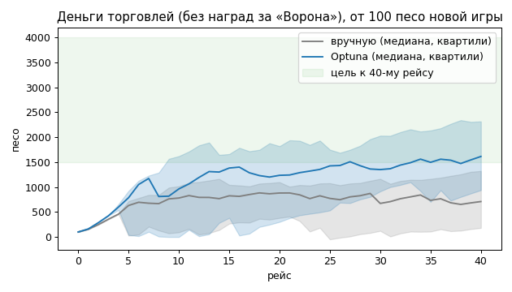
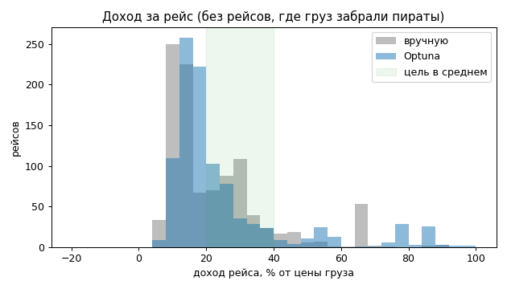
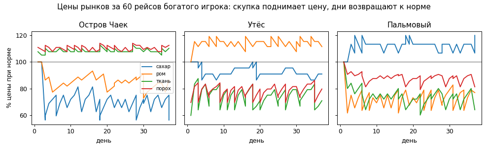

# Экономика архипелага

Торговля в игре (`game/program/trade.c`) — три порта, четыре товара, цены зависят от запаса на
складе. Таблицы рынков (`game/program/market.c`) подобраны симулятором `economy/`. Это отдельная
агентная модель на Python, движок ей не нужен.

Файл генерирует `economy/report.py`.

## Модель

- **Рынки** (`sim.Markets`) построчно повторяют `trade.c`, включая целочисленную арифметику
  скриптового языка. Цена — `база × % острова × (200 − запас/норма)`, коридор 50…150%. Покупка идёт
  поштучно, каждая единица дороже. Рынок берёт товар по `MARKET_BUYS`% своей цены. С каждым днём
  карты запас проходит `MARKET_RECOVERY`% пути к норме, но не больше десяти дней за раз.
- **Мир** (`sim.World`) моделирует карту:
  - переходы между портами по координатам `make_worldmap.py`: бриг идёт ~40 м за игровой час, ветер даёт 0.8…1.2;
  - штормы (+2…6 часов);
  - «Ворон»: с грузом догоняет вдвое чаще. Если бриг проигрывает бой, пираты забирают груз, а бриг уводят на Остров Чаек.
- **Агенты**:
  - `Greedy` — игрок, знающий цены. Грузит единицы с лучшей маржой на лучший порт и продаёт всё по прибытии.
  - `Wanderer` — игрок, который цены не сравнивает: случайный товар, случайный порт.

## Сверка с игрой

`replay.py` прогоняет строки `TRADE:` из лога движка через модель. Каждая сделка должна совпасть по
песо, остатку склада и кошельку. Тесты (`economy/tests`) проверяют на совпадение три лога:

| Лог | Таблицы | Что в нём |
|---|---|---|
| `autotrade.log` | ручные | рейс автотеста: ткань с Острова Чаек на Утёс, потеря груза |
| `fuzz.log` | ручные | 300 случайных сделок `fuzz_autotest.c` в трёх портах, дни идут |
| `fuzz_tuned.log` | Optuna | то же на подобранных таблицах |

## Цели баланса и результат

`tune.py` ищет таблицы с Optuna (TPE, 400 проб). Свободны процент цены и норма каждого товара на
каждом острове, скорость восстановления и наценка рынка. «Сюжет» островов сохраняется: что остров
производит, стоит там меньше 100% базы, чего ему не хватает — больше. Каждая проба — 12 сидов по 40 рейсов
для трёх игроков: бедного, богатого и случайного.

| Метрика | Вручную | Optuna | Цель |
|---|---|---|---|
| доход за рейс, старт 100 песо | +23% | +26% | 20…40% |
| доход за рейс, старт 5000 песо | +18% | +18% | 10…40% |
| песо торговлей за 40 рейсов (медиана) | 710 | 1614 | 1500…4000 |
| доля прибыли лучшего маршрута | 0.37 | 0.36 | ≤ 0.5 |
| товар на краю ценового коридора | 0.0% | 0.0% | ≤ 5% |
| доход случайного игрока | -13% | -3% | −30…0% |
| рейсов, где пираты забрали груз | 10% | 9% | — |
| игр, где торговля ушла в минус | 23% | 10% | — |
| песо вместе с наградами за «Ворона» | 8387 | 8174 | — |
| **счёт** (0 — все цели выполнены) | 2.49 | 0.00 | |

Что показала модель:

- **Ручные таблицы.** Деньги торговлей приходили медленно. Игрок, вкладывающий в груз все песо, часто
  заканчивал в минусе: одна потеря груза съедала всё.
- **Подобранные таблицы.** Рынок платит ближе к своей цене (меньше спред), но у каждого товара своя
  норма запаса, поэтому большие партии быстрее упираются в рост цены. Доход стал ровнее, разорений
  меньше.
- **Награды за «Ворона».** Они дают игроку больше денег, чем торговля. Торговля в игре — способ
  начать и пережить потерю, а не главный источник дохода. Если её нужно сделать главной, есть два
  рычага: уменьшить `RAVEN_REWARD` в `world.c` или поднять наценки.
- **Шансы встречи и победы в бою.** В модели это оценки (`sim.Risk`), а не замер из игры. Их стоит
  уточнить логами игровых сессий.







## Таблицы `market.c`

Процент базовой цены / норма запаса. Базовые цены: сахар 20, ром 40, ткань 60, порох 80.
Восстановление 20% в день (было 20%), рынок берёт по 95% (было 85%).

| Остров | сахар | ром | ткань | порох |
|---|---|---|---|---|
| Остров Чаек | 160% / 70 (было 140% / 40) | 110% / 40 (было 130% / 40) | 65% / 120 (было 70% / 120) | 80% / 165 (было 80% / 100) |
| Утёс | 110% / 130 (было 120% / 50) | 65% / 125 (было 70% / 120) | 120% / 25 (было 130% / 40) | 135% / 60 (было 140% / 40) |
| Пальмовый | 75% / 170 (было 60% / 150) | 130% / 60 (было 110% / 60) | 125% / 25 (было 140% / 30) | 120% / 55 (было 120% / 50) |

## Что если: торговцы-конкуренты

В игре на рынок влияет только игрок. Модель позволяет пустить рядом NPC-торговцев с той же
стратегией. Чем их больше, тем быстрее закрывается разница цен.

| NPC-торговцев | доход игрока за рейс |
|---|---|
| 0 | +19% |
| 2 | +7% |
| 5 | +4% |
| 10 | +2% |

## Запуск

```bash
python3 -m venv --system-site-packages venv && venv/bin/pip install optuna==4.1.0 pytest==8.3.3
cd economy
../venv/bin/python -m pytest -q            # сверка с игрой и цели баланса
../venv/bin/python tune.py --write         # подобрать и записать market.c (~3 мин)
../venv/bin/python report.py               # этот отчёт
../venv/bin/python replay.py ~/.local/share/Akella/Sea\ Dogs/Logs/compile.log   # сверить свою игру
```
