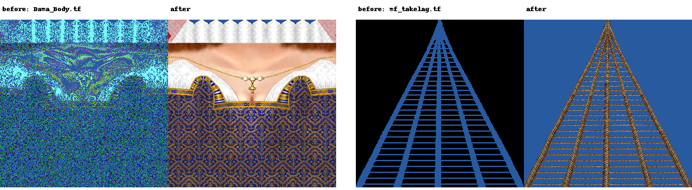
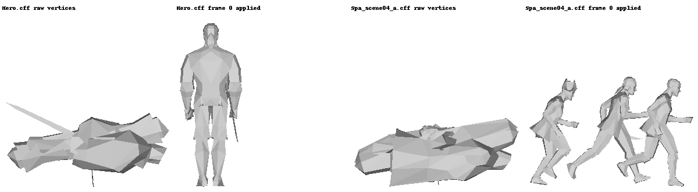
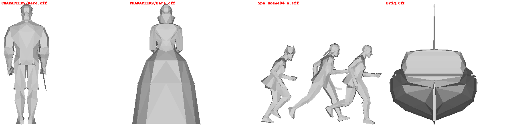
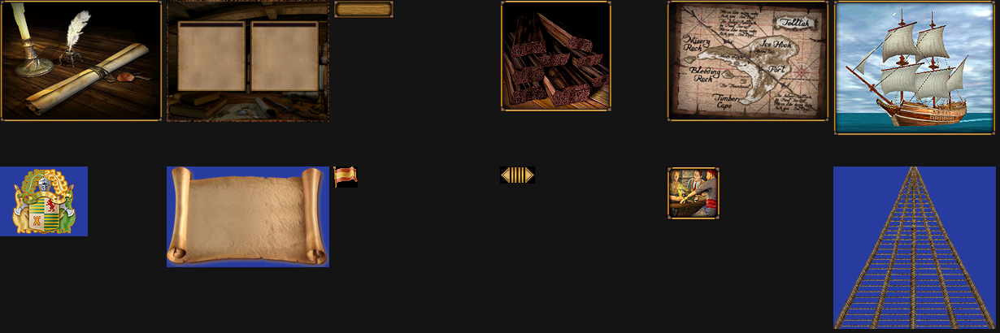
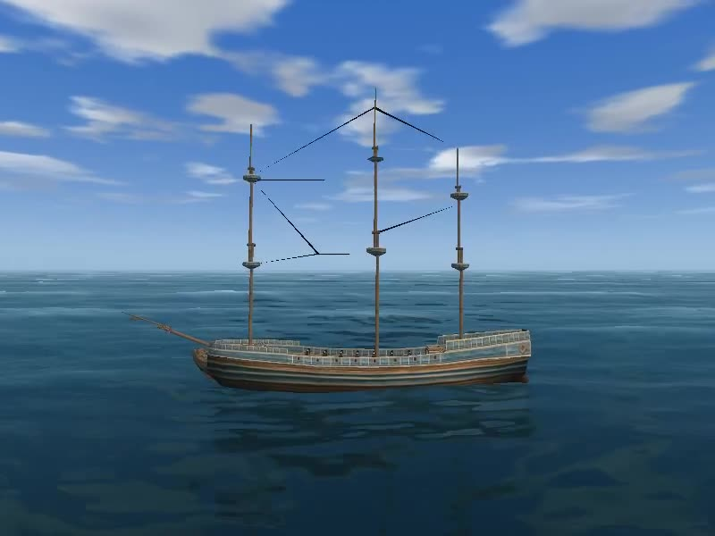

# Оригинал и ремейк: как устроены, чем отличаются, что нашли

Оригинал — «Корсары: Проклятье дальних морей» (Akella, 2000, PDM 1.061, движок Storm 1). Ремейк — то же содержимое на открытом Storm Engine (ветка `pdm-launch`, сборка под Linux и Windows). Здесь собрано то, что выяснилось при разборе оригинала: декомпиляция DLL, разбор файлов, проверки конвертеров. Картинки в [media/](media/) — внутренние тесты конвертеров.

## 1. Как сделан оригинал

```
ENGINE.exe            ядро Storm 1: менеджер сущностей, сообщения, файловая система, D3D
MODULES/*.dll (104)   каждая — набор сущностей, экспорт один: Entity* CreateEntity(char*)
RESOURCE/             данные: модели, текстуры, квесты, диалоги, персонажи, миры
```

- **Логика написана на C++ и лежит в DLL.** Скриптового языка нет. Сюжет, квесты и торговля — класс `LCORE` в `CORE.dll` (строки `LCORE::AdvanceStoryLine`, `LCORE::SetStoryLineQuest`). Корабли — `SHIP.dll`, карта — `MAP.dll`, диалоги — `DIALOG_TERMINAL.dll` и т. д. Модули обмениваются сообщениями с числовыми кодами: например, `0x2329` загружает квест `%s.ql`.
- **Игра управляется данными, а данные сделаны редакторами, которые входят в саму игру.** В `MODULES` лежат `QUEST_EDITOR`, `ACTION_EDITOR`, `DIALOG_EDITOR`, `CHARACTER_EDITOR`, `TOOLS_SHIPEDITOR`, `TOOLS_TACTIC` — внутриигровые инструменты дизайнеров на тех же сущностях и том же интерфейсе (`ws_hmenu`, `wspopup`). Их файлы читает рантайм:
  - `ACTIONS/*.a` — скрипты действий на маленьком командном языке (715 файлов);
  - `QUESTS/*.ql` — графы квестов;
  - `DIALOGS/*.d` — деревья диалогов;
  - `CHARACTERS/*.mtx`, `SHIPS/*.shp` — карточки персонажей и кораблей;
  - `WORLDS/*.idf` — таблицы свойств (острова, города, локации).
- **Многие двоичные файлы — просто дамп C-структуры из памяти редактора.** `.mtx` всегда 2384 байта, `.shp` — 792. Внутри остались следы памяти: указатели кучи в первом поле записей `.idf`/`.ql` и заполнитель MSVC `0xCCCCCCCC` (неинициализированный стек debug-сборки) в `.mtx` и `Reef.CfF`.

Пример: расшифрованный `ACTIONS/Andreas Fickler.a` — назначение диалога и места персонажу:

```
SET_FOR Person "Andreas Fickler" Dialog "Second_hire"
SET_FOR person "Andreas Fickler" location "Belflor.street"
```

Диалог `.d` — размеченный текст cp1251:

```
<N node_1>
<T Добрый день, сэр. Простите, если я вам помешал. К сожалению, я не вижу вас. ...>
<L link_1_1,1,1,node_2>
<T А теперь ты спросишь, не найдется ли у меня лишней монетки для старого слепого моряка.>
```

Таблица `WORLDS/islands_x.idf` (29 объектов), запись острова:

```
name = avilia   class = Granda Avilia   map_cell = 186,392,505   type = 22,7,100
trade_name = Warehouse   town = City_GrandaAvilia   nation = 3
```

## 2. Как сделан ремейк

- **Движок** — открытый Storm Engine (наследник Storm 2.x, на нём «Корсары: Каждому своё»). Сущности — C++-модули, собранные в один бинарник.
- **Логика — на скриптах** `program/*.c`. Это C-подобный язык, движок компилирует его при запуске; правка логики не требует пересборки.
- **Графика** — DirectX 9. Под Linux её даёт dxvk-native поверх Vulkan, окно и ввод — SDL, звук — miniaudio (ветка `miniaudio-sound`).
- **Форматы:** текстуры `.tx`, геометрия `.gm` (RDF с BSP для трассировки), скелетная анимация `.an`, частицы `.xps`, шрифты `fonts.ini`.
- **Конвертер** `tools/convert.sh` / `convert.ps1` / `convert.bat` (ядро — `tools/pdm2storm.py`) одной командой переводит весь `RESOURCE` оригинала: графику — в форматы движка (`out/resource`), игровые данные (действия, диалоги, таблицы, персонажи, корабли) — в JSON, который читают наши скрипты (`out/data`). Описание этапов — в [pdm-formats.md](pdm-formats.md).

## 3. Отличия

| | Оригинал (Storm 1, 2000) | Ремейк (Storm Engine) |
|---|---|---|
| Логика | C++ в 104 DLL, `LCORE` в CORE.dll | скрипты `program/*.c`, компилируются движком |
| Данные игры | двоичные файлы из внутриигровых редакторов | конвертируются в текст / скрипты |
| Модули | DLL, `CreateEntity(char*)` | статически в `engine`, регистрация классов |
| Текстуры | `.tf`: 16 бит, 565/1555/4444, инверсная альфа | `.tx` A8R8G8B8 с мипами |
| Модели | `.cff`: int16-квантование, части с кадрами анимации | `.gm`: float, нормали, BSP |
| Анимация персонажа | жёсткие части, ключи на каждую часть | скелет `.an` + скиннинг |
| Скрипты действий | `.a`, байты «зашифрованы» циклическим сдвигом | JSON: команда + аргументы |
| Персонажи, корабли | `.mtx` / `.shp` — дампы структур редактора | JSON с именованными полями |
| Платформа | Windows 98, D3D6/7 | Linux / Windows, D3D9 → Vulkan |

## 4. Что интересного нашли

### Текстуры: другая раскладка пикселей и инверсная альфа

У трёх типов пикселей `.tf` публичный шаблон `TF.bt` путает 565 и 1555, а альфа в файлах инвертирована: установленный бит означает «прозрачно». Слева — декодирование по шаблону, справа — исправленное `tools/tf2tx.py` (фон синий, чтобы видеть прозрачность).



Проверка без «на глаз»: по 388 текстурам type 1 соседние пиксели в верной раскладке отличаются в среднем на 3.4, в неверной — на 12.3 (шум).

### Модели: части персонажа хранятся в своей системе координат

У персонажей и катсцен каждая часть тела — отдельный меш со своими ключами анимации. Вершины лежат в локальной системе части, а на место её ставит кадр 0: translation + rotation в радианах. Без этого все части сваливаются в кучу у начала координат.



Порядок поворотов в файле не записан. Его подобрал перебор 48 вариантов на 84 персонажах: в верном варианте суммарный зазор в суставах минимален. Победил `Ry·Rx·Rz` (65 побед из 84) — это `D3DXMatrixRotationYawPitchRoll`. В плагине Noesis знак оси Y перевёрнут.

### Две версии формата CFF

26 старых моделей (`torus`, `Shlop`, `tavern_new`, `Panorama`…) хранят вершину в 12 байтах вместо 13 — без одного байта цвета. Доказательство: заголовок следующего меша начинается ровно после `vc*12 + fc*3` байт. Результат конвертации — бриг, Hero, Dama и сцена:



### «Шифрование» скриптов действий

`.a` защищены от правки блокнотом: байт `i` каждого 8-байтного блока сдвинут вправо на `i` бит. В `CORE.dll` (`FUN_10001150`) видно, как игра сама это расшифровывает и построчно отдаёт интерпретатору; строки, начинающиеся с `/`, — комментарии:

```c
bVar2 = buf[n];
buf[n] = bVar2 >> (i & 7) | bVar2 << 8 - (i & 7);   // i = n % 8
...
if (line[0] != '/') FUN_100014a0(line);             // выполнить команду
```

Команды в 715 файлах: SET_FOR 980, ADD 541, SET 507, DELETE 129, LAUNCH 73, OPEN 42, PLAY 15, MESSAGE 12, END 2.

### Картинки интерфейса: та же инверсная альфа в TGA

425 TGA без `.tf`-пары — иконки товаров, кнопки, фоны, карта. 305 из них 16-битные, и альфа-бит не стоит ни в одном пикселе. По стандарту TGA это полностью прозрачные картинки (первый тест конвертера показал пустые синие прямоугольники). На деле у Akella альфа и здесь инвертирована, как в `.tf`: ноль означает «непрозрачно». У 32-битных TGA альфа обычная — гербы и свиток вырезаны по контуру:



### Карточки персонажей и кораблей прочитаны по коду редакторов

`.mtx` (2384 байта) и `.shp` (792 байта) — дампы структур, у которых нет ни заголовка, ни имён полей. Декомпиляция `CHARACTER_EDITOR.dll` дала функцию, которая собирает 2384 байта из 12 кусков объекта редактора (`malloc(0x950)`, первым словом пишет размер). Рядом в коде стоят подписи формы (`name:`, `nation:`, `3D model:`, `officer rank:`, `Sailing:` …), и по ним поля получили имена. Проверка на данных: у Адама Муллена ранг 2 (`MASTER_PURSER`, казначей) и единственный ненулевой навык — третий, Commerce. В его диалоге он и нанимается казначеем.

`TOOLS_SHIPEDITOR.dll` пишет `.shp` тремя `fwrite` из глобальных структур (4 + 0x2f0 + 0x24 байт). Груз корабля — массив `int[128]` по номерам строк `Goods.idf`: 0–2 — пушки, 3–6 — книппели, картечь, бомбы, ядра, дальше товары. Пример — `Anaga.shp`: фрегат `VFrigat`, 300 матросов, 8000 HP корпуса, 10 кульверин, 600 книппелей, 600 картечи, 400 бомб, 900 ядер.

### Сюжет — это машина состояний в данных

Весь сюжет PDM держится на трёх видах файлов, которые соединяет `CORE.dll`:

```
QUESTS/Alameda_delivery.ql            сюжетная линия
  Check_reputation   OBTAIN Reputation 5                       -> ACTIONS/Alameda_check_ok.a
  void
  Deliver_Alameda    ESCORT Person "Tedoro Alameda" -> sinistra -> ACTIONS/Alameda_dlivered.a
ACTIONS/*.a                            SET_FOR Story_line "..." Quest "Deliver_Alameda", ADD Item, SET_FOR Person ... Dialog ...
DIALOGS/*.d                            <A action> у реплики запускает ACTIONS/<action>.a (894 из 894 найдены)
```

Реплика диалога запускает действие, действие переключает квест линии, а выполненное условие квеста запускает следующее действие. Условий всего пять: NO CONDITION, OBTAIN, KILL, ESCORT, MATCH. В ремейке эту машину нужно будет написать на `program/*.c` поверх JSON из `out/data`.

Мелочь про инструменты: условие `KILL` не нашлось в выгрузке строк Ghidra, потому что строки короче 5 символов туда не попадают. Полный список типов и условий дало чтение таблиц указателей прямо из `.data` DLL.

### Корабль оригинала на море Storm 2

[](../pdm-sea/media/pdm-sea.mp4)

Первая сцена ремейка на данных оригинала — `pdm-sea/`. В оригинале корабль — это не одна модель, а дерево из `DESC/<корабль>.def`: корпус, мачты, такелаж и пушки — отдельные `.cff`, смещения которых складываются по ссылкам на родителя. Storm 2 ждёт один `.gm`, поэтому `tools/pdm_ship.py` собирает части в одну модель. Масштаб DEF — условные единицы: бриг длиной 1,17 приходится увеличить в 26 раз.

Море, небо и физика корабля — из демо `ship` движка, сцена запускается командой `pdm-sea/run.sh <engine>` (переменная `PDM` указывает на папку игры). Камера облетает корабль сама: для этого в `SHIP_CAMERA` добавлены атрибуты `AngleY`/`AngleX` (коммит движка `d3b4a2f3`), и видео пишется без единого нажатия.

Облёт показал разницу в отрисовке. Движок PDM не отсекал задние грани, а Storm 2 отсекает. Поэтому всё, что в данных оригинала обмотано «не той стороной», в ремейке превращалось в дыры: левая половина носа брига — зеркальная копия правой с той же обмоткой. `cff2gm` теперь делает грани CFF двусторонними. Чёрная крышка над трюмом `ABrig_Patch.cff` смотрит вниз, а в оригинале, видимо, не пускала море внутрь корпуса; в Storm 2 она не нужна и не переносится.

Паруса и такелаж в Storm 2 — не геометрия модели, а сущности движка, которые читают метки `.gm`. Паруса брига описаны в `DESC/ABrig.sls`: четыре угла и реи на каждый парус. Реи идут в модель, а углы становятся метками для сущности `sail`, и она сама надувает полотно ветром. Штаги и ванты оригинала — плоские треугольники в CFF. Из них получаются концы тросов для `rope` и пары «топ мачты — борт» для `vant`, которая рисует ванты с выбленками. Тросы долго не было видно, и выяснилось, что оригинал гасил тонкий такелаж через мип-уровни текстуры `black`: альфа падает с 255 до 34. В Storm 2 с альфа-тестом такие тросы исчезали почти сразу, поэтому текстуры тросов и вант генерируются заново.

### Подсказки, которых никто не видел

Интерпретатор `.a` в `CORE.dll` берёт имя команды до первого пробела. В его таблице команда называется `MESSAGE BOX` с пробелом, поэтому строка `MESSAGE BOX String "Good question!"` никогда не совпадает. 16 таких подсказок и 4 варианта `message_box` в оригинальной игре не срабатывали. Ремейк может их показать — это первая возможность сделать лучше оригинала, оставаясь верным его данным. Полная таблица команд и их действий — в `pdm-formats.md`, раздел A.

### Битые файлы в релизе

- `ABrigCan.cff`: меш 59 на 2 байта короче своего заголовка (такой же меш у других пушек цел).
- `Reef.CfF`: `MaterialCount = 0xCCCCCCCC`.

- `DESC/Manowar.CfF` (май 2000) — устаревшая копия `MODELS/Manowar.CfF` (июль): 388 байт отличаются, в старой поля заголовка залиты `0xCC`. Июльский файл цел.
- `SHIPS/reserved/empty.shp` — 740 байт вместо 792, шаблон ранней версии редактора.

Игра, видимо, их не грузит. Конвертер пропускает их с понятной ошибкой.

### Краш нового движка на данных оригинала

Первый запуск упал в `NODER::Trace(this=0x0)` ← `MODELR::Trace` ← `InterfaceBackScene::CheckMousePos`: модель без файла геометрии всё равно трассировалась мышью. Исправлено проверкой `root == nullptr` в `model.cpp` (коммит движка `c2eab95f`); рецепт отладки под gdb — `engine/docs/ru/07-debugging.md`.

### Невидимые стены: как персонаж ходит в оригинале и в Storm

**Симптом.** На улице Granda Avilia были места, где нельзя перейти на другую сторону, хотя можно обойти с другой стороны. В таверне автотест останавливался в 4 м от падре Игнасио: Goto к нему принимался, но герой не шёл.

**Как ходят персонажи.**

| | Оригинал (MAN.dll, 2000) | Storm Engine (`.ptc`) |
|---|---|---|
| Пол | патч: точка проверяется перебором всех треугольников, они могут перекрываться и быть любыми иглами | навигационная сетка: треугольники без перекрытий, сосед через общее ребро |
| Препятствия | пять «усов» — лучи на высоте 0,3 м (0,285 м вперёд, 0,275 м назад, 0,395 м под 45°, 0,375 м вбок); вдоль препятствия герой скользит | вырезаны из пола заранее; край пола и есть стена |
| Путь NPC | по точкам локации, графа нет | таблица путей: для каждой пары треугольников 2 бита — ребро, через которое идти |
| Цена шага | перебор патча и пять трассировок за кадр | проверка трёх соседей, путь уже посчитан |
| Память | только треугольники | таблица растёт как N²: город на 2 600 треугольников — ~1,7 МБ, `patch_grot.ptc` — 39 МБ |

**Как появились стены.** Пол `.ptc` строит наш конвертер `tools/pdm_world.py` из патча оригинала, и швы появлялись на этом пути:
1. Патчи оригинала — вееры длинных тонких треугольников из одной вершины (например, полоса 0,15 × 20 м вдоль улицы). Пол помещений, которого нет в патче, наш `ear_clip` резал так же: брал первое подходящее «ухо».
2. Препятствия вырезались клетками по 0,15 м из каждой иглы отдельно, а куски тут же резались на треугольники. Точки разреза у соседних игл расходились на миллиметры или сантиметры: (1,8; 3,494) против (1,8; 3,498), 5,85 против 5,805.
3. После привязки к сетке 1 мм веер тонкой щепки выворачивался. `clean_patch` видел складку и отделял её как стену.

Итог: на улице был шов 9,7 м вдоль улицы у x≈19,8, а в таверне вход был отрезан от зала.

**Что исправлено** (`tools/pdm_world.py`):
- `ear_clip` выбирает самое «толстое» ухо;
- препятствия вырезаются выпуклыми кусками, без нарезки на треугольники;
- вершины одного уровня ближе 4 мм сливаются;
- куски тоньше 2 мм выбрасываются;
- в веере остаются только треугольники с ориентацией контура.

| | было | стало |
|---|---|---|
| таверна, швы | 26 | 2 (по 0,1 м, на втором этаже) |
| таверна, вход и зал | отрезаны друг от друга | связаны, точка падре в той же части |
| город, швы | 129, длиннейший 9,7 м | 59, длиннейший 1,05 м |

Оставшиеся швы в городе — у ступенек и у подножия крутых лестниц (подъём 4,25 м на 1,4 м). Лестницы пока отрезаны от улицы, это отдельная задача. Найти швы: `tools/ptc_seams.py` ищет рёбра без соседа, за которыми в 3 см снова пол той же высоты, и считает несвязные части пола (`test-commands.md`, «Мир и патчи»).

**Что лучше.**
- **По производительности и навигации NPC выигрывает Storm.** Шаг стоит O(1), путь к любой цели готов заранее, NPC обходят препятствия сами.
- **Оригинал терпимее к «грязной» геометрии.** Швов у него не бывает в принципе, памяти почти не нужно. Но перебор растёт линейно с размером локации, а пяти лучей и пути «по точкам» хватает только на героя и простых NPC.
- **Беда была не в движке Storm**, а в переводе старых данных под его строгую сетку: сетке нужны общие рёбра без перекрытий и без стыков «в Т».
- **Слабое место Storm — таблица путей N².** Если она станет мешать на больших локациях, путь можно искать в рантайме: A* по графу соседей или иерархические порталы.

**Зачем тогда сделали новую систему.** У оригинала на суше ходит в основном герой, а NPC стоят на своих точках или ходят между ними. Storm Engine делали для «Пиратов Карибского моря» / «Корсаров 2» (2003) и следующих игр. Там на суше живой город: горожане и патрули гуляют по улицам, бои на саблях идут в городе и на абордаже, NPC догоняют, следуют за героем и убегают. Всё это требует, чтобы десятки персонажей сами находили дорогу, и для этого сетка выгоднее:
- **Путь, а не только столкновение.** «Усы» лишь говорят, что впереди стена, а куда её обходить — не говорят. Сетка с таблицей путей сразу даёт ребро, через которое идти к любой цели: NPC обходит дома и столы без поиска пути.
- **Цена не зависит от толпы.** Шаг персонажа — проверка трёх соседей текущего треугольника, а не перебор патча и пять трассировок по геометрии. На CPU 2003 года это и позволяло держать на улице десятки персонажей. Таблица считается один раз, в редакторе, а не в игре.
- **Персонаж не может оказаться вне пола.** Он всегда стоит на известном треугольнике. Нет застреваний в углах, где лучи «не дотянулись», и провалов сквозь щель между перекрытыми треугольниками.
- **Пол задаёт дизайнер.** Где ходить, решает патч из редактора, а не случайная геометрия модели. Высоту персонажа на склонах и лестницах берут из плоскости треугольника.
- **Материал пола.** У каждого треугольника есть материал, по нему выбираются звуки шагов (у нас — `pdm_sound.step_material`).

Плата за это — сетку надо строить аккуратно, а таблица занимает память. В оригинальных играх Storm патчи делали в редакторе сразу под сетку, поэтому швов не было. У нас сетку приходится выводить из патчей другой системы: отсюда швы и генератор `pdm_world.py`.

### Верфь: что делает игрок (по `TOWN.dll`)

**Механика.** Игрок заходит к владельцу верфи, выбирает окно верфи. Экран показывает корабль героя: название типа, описание, картинку, характеристики (класс, корпус, скорость, маневренность, команда, трюм, орудия, борт/корма, калибр, вес ядра, дальность, перезарядка) и орудие с его картинкой.

**Шаги игрока и режимы экрана.**
1. Режим 0, «свои корабли»: слева стрелки выбора корабля, под картинкой кнопки «Продать», «Полностью», «Починить»; в рамке «Корпус»/«Оснастка» процент износа и сумма ремонта стрелками ± (кнопки `lb_LeftHull/RightHull/LeftRig/RightRig`); справа список своих кораблей («Ваш корабль») и списки купленных типов по классам.
2. Режим 1, «купить/заменить»: выбирается тип из списка справа. Кнопка «Замена» (`lb_Upgrade`) срабатывает, если хватает золота и ранг позволяет такой класс; иначе в окне подсказки одна из строк отказа («не хватает денег», «ранг не позволяет»). Цена замены считается как разница цен нового и старого типа за корпус.
3. Режим 2, «обшивка» (`lb_Refit`): показывает «Sheathe cost %d gold», кнопка обшить доступна, пока обшивка не стоит.

**Условия.** Купить можно тип, класс которого не выше разрешённого рангом (текст «Ваш ранг позволяет управлять вам кораблями до N класса»). У героя должно хватать золота на цену. Продажа и ремонт работают только с кораблём героя из списка; продать единственный корабль нельзя (кнопка «Продать» гаснет у лодки).

**Перенесено в ремейк:** экран `shipyard` с названием, описанием, картинками корабля и орудия, характеристиками, ценой и списком типов (`screens.c`, тест `shipyard-screen`).

**Износ корабля (наше).** Состояние корпуса и парусов героя хранится в карточке корабля (`hull_hp`, `rig`): пишется при выходе с моря (`Sea_Release`), читается при создании корабля героя в бою (`Battle_AddShip`), сбрасывается при покупке другого корабля. На верфи «Корпус»/«Оснастка» показывают проценты, «Починить» чинит выбранные доли корпуса и оснастки, «Полностью» — весь износ, сколько позволяют деньги; стрелки ±Корпус/±Оснастка меняют долю износа к ремонту шагом 10% (сумма под рамкой пересчитывается); цена — по формуле оригинала (абзац «Цена ремонта и продажи своего корабля» ниже). Тест: `shipyard-screen`, маркер `repair ok`.

**Ещё нет:** формулы цены ремонта и продажи (в декомпиляции на x87, Ghidra потеряла аргументы `__ftol`; нужен разбор ассемблера `FUN_10005310`), точный список по рангу, действия кнопок, «Доступные калибры».

**Цена ремонта и продажи своего корабля (по ассемблеру `FUN_10005310`).** Стоимость корабля героя `P` = меньшее из `B + s` и `A − s` (те же `A`, `B`, `s`, что в абзаце про цены кораблей), округлённое вниз до сотен. Продажа: игрок получает `P · (0,5 + 0,375 · корпус% / 100 + 0,125 · оснастка% / 100)` (целая часть): целый корабль — `P`, совсем разбитый — половина. Ремонт: корпус стоит `% · P / 100 · 0,25`, оснастка — `% · P / 100 · 0,125` (`%` — выбранная доля починки, целая часть); «Полностью» — то же на весь износ (до 100%). Отдельные надбавки по классу корабля (`7 − класс` за корпус и `(7 − класс) / 2` за оснастку) в коде есть, но включаются битовой маской `0x1001f51c`, которая в `TOWN.dll` только обнуляется при загрузке и нигде не ставится, поэтому в игре они всегда нулевые. Перенесено: `Screen_OwnValue`, `Screen_OwnSellPrice`, `Screen_RepairPrice` (`screens.c`), тест `shipyard-screen` (`repair ok`, «repaired for 1012» / «1517»). **Кнопки ремонта (по обработчику `0x10006ff0…`, применение `0x10006ba0`).** Стрелки ±Корпус / ±Оснастка двигают выбранную долю на 10% (не ниже текущего состояния, не выше 100%); после «+» долю уменьшают на 1%, пока денег не хватает на корпус и оснастку вместе. «Починить» применяет обе выбранные доли сразу (корпус и оснастку), списывает сумму обеих. «Полностью» ставит обе доли на 100%, затем сначала снижает корпус, потом оснастку по 1%, пока денег хватает, и чинит, сколько получилось (отказа «нет денег» нет: на нуле просто ничего не меняется). Тест: `repair ok`, `partial repair ok`.

**Что не нашли.** Ghidra сама не выгружает функцию загрузки верфи: нужен `ENTRIES="10003d10"`. Поля типа корабля читаются со сдвигом `0xe0` на запись в таблице модуля (`0x222c0` — ограничение по рангу/классу, `0x2234c` — цена, `0x2239c` — флаги орудийных портов): смысл выведен из использования, не подтверждён.

**Ранг и класс.** Предел класса при окне верфи считается из ранга героя (поле героя `+0x1cc`): `6 − (ранг − 1) / 2` (целое, деление к нулю), но не меньше 1: ранги 1–2 → 6, 3–4 → 5, 5–6 → 4, 7–8 → 3, 9–10 → 2, от 11 → 1. Купить можно корабль, чей номер класса не меньше предела; иначе верфь пишет «Ваш ранг позволяет управлять кораблями до %d класса» (`ShipYardBuyButClass`). Перенесено: `Screen_RankClass`, `Screen_HeroRank`, отказ в `LB_BUY` (`screens.c`), тест `shipyard-screen` (`refused, rank`). Чего нет: фильтра списка типов по классу (у оригинала короче нашего, см. выше).

**Цены кораблей (по ассемблеру `FUN_10005c00`, `FUN_10005310` — x87, Ghidra константы теряет).** У каждого типа две цены: полная `A` (`buyprice` данных) и меньшая `B` (`sellprice`). Верфь считает поправку `s = |A−B| · 0,5 · (R + K) · 0,01`, где `R` — «репутационная» добавка героя (поле героя `+0x3d8`: к нему прибавляется 5 в сторону знака, делится на 10 нацело и умножается на 10, затем зажимается в [−30; 30]), `K` — навык № 2 героя (с учётом офицеров), умноженный на 5 и ограниченный сверху 95. Цена, по которой игрок покупает, — `A − s`; цена, по которой игрок продаёт, — `B + s`, но не больше цены покупки; обе округляются вниз до сотен. Чем выше навык, тем дешевле покупка и дороже продажа; без навыка и репутации — `A` и `B`. Замена корабля: разница цен нового и старого (по модулю), если она отрицательна — игрок получает деньги.

**Навык № 2 — Торговля.** Порядок навыков в `RESOURCE\WORLDS\skills.idf`: sailing, repair, commerce, accuracy, reloadspeed, coordination, combat, shielding; номер 2 — `commerce`. Сверка со скриншотом оригинала: новый герой с нулевой Торговлей видит цену Шнявы 20000 = `buyprice` без поправки. Поправка в ремейке: `Screen_PriceShift`.

**Перенесено:** `R` — репутация героя (`PlayerCard.reputation`), `Trade_Rep` в `trade.c`, `Screen_PriceShift` в `screens.c`.

## Магазин (экран `trade`, `TOWN.dll`)

**Механика.** В магазине острова игрок видит семь строк товаров (орудия в список не входят), слева — трюм (на борту, цена продажи), справа — склад (в магазине, цена покупки, метка «Экспорт»/«Импорт»). Под списками — описание, характеристики и «Деньги N»; справа поле «Количество».

**Шаги игрока.** Выбрать товар стрелками; кнопки ◄/► меняют количество (шаг 1; для ядер, картечи и книппелей — 20; с Shift ×10), «Всё» берёт весь трюм, а если он пуст — сколько можно купить; «Купить»/«Продать» делают сделку.

**Склад и цены (при каждом открытии магазина).**
- Норма запаса: экспорт 300…548, импорт 80…128, прочие 100…148, контрабанда 0; для ядер ×30, для досок и парусины ×5; делится на вес товара.
- Цена магазина A: экспорт — цена/(1,3 + 0…16/35); импорт — цена·(2 + 0…34/35); прочие — цена·(1 + (0…27 − 14)/35). Цена, по которой магазин платит, B = A/(1,4 + 0…9·0,04).
- Запас: что было + норма (при первом визите — две нормы); выше нормы падает до нормы минус случайная треть. Пополнение идёт в дни 1 и 16 месяца.
- Навык «Торговля»: t = навык·5 (до 95). Магазин просит A − (цена − A)·t%, платит B + (A′ − B)·t%, не меньше 1 и не больше своей цены. Пока окно открыто, цены стоят, меняется только запас.

**Отказы.** Покупка ограничена запасом, свободным весом трюма (вес ядер считается за 20 штук) и деньгами; продажа — тем, что в трюме. Если просили больше, берётся максимум, под полем появляется пояснение.

**Перенесено.** `program/trade.c`, `tools/pdm_trade.py` (метки из `.gst`), тексты «Экспорт/Импорт/Деньги» через `pdm_ui.py`; тест `screens` (`PDM trade: bought/sold`), кадр экрана сверен с эталонными скриншотами.

**Цена по острову.** Начальная цена товара умножается на процент острова — третье число `type` в `islands_x.idf`: 130 на Shark Island и Gray Sails, 10 на «мёртвых» вариантах, на остальных 100. Перенесено: `Trade_IslandPct` (`trade.c`), проверка в `Trade_Check` (`store-screen`).
**Нет.** Игровой даты (у нас +15 дней за визит, первый визит — месяц).

**Адреса (справка).** `0x1000b2e0` — склад и цены; `0x1000cdb0` — обработчик количества; `0x1000848b` — установка t; `0x1001225c` — `__ftol`, `0x1001241e` — `rand`.

## 5. Как проверяем (внутреннее тестирование)

| Что | Как | Результат |
|---|---|---|
| Текстуры | все `.tf` → `.tx`, композит на синем фоне, метрика соседних пикселей | 2742 файла, 0 ошибок |
| Модели | все `.cff` → `.gm`, рендер треугольников из того, что уходит в `write_gm` | 677 из 679 (2 битых в оригинале) |
| Части персонажей | зазор между частями по 84 моделям, 48 вариантов поворота | `Ry·Rx·Rz`, 65 из 84 |
| Действия | расшифровка 715 `.a`, разбор по таблицам команд и типов из `CORE.dll` | 2433 команды с известным эффектом, 28 строк оригинал игнорирует |
| Таблицы IDF | разбор `n × (u32, имя[64], значение[64])` до конца файла | 96 из 96 |
| Картинки TGA | все 425 → `.tx`, композит на синем фоне, статистика альфа-бита | 0 ошибок, альфа инвертирована у 16-бит |
| Персонажи, корабли | разбор по коду редакторов, сверка навыков и ранга с диалогами | 297 `.mtx`, 94 `.shp` |
| Сюжетные линии | разбор `.ql` до байта, поиск каждого `action` в ACTIONS | 76 файлов, 106 из 106 действий найдены |
| Весь RESOURCE | `make_korsari_run.sh` → `convert-report.json` | ~10 тыс. файлов за 43 с, 4 ошибки — все битые в оригинале |
| Движок | запуск собранной папки под gdb, `error.log` | краш найден и исправлен |
| Корабль на море | `pdm-sea` через `record.sh`, облёт камеры, кадры через ffmpeg | ABrig: 8 частей, 190 мешей, 22 текстуры, 9 парусов, 8 штагов, 12 вант; `error.log` пуст |
| Каркас игры (П1) | `pdm-game/run.sh`, сводка загрузки в `compile.log` | 43 корпуса, мир оригинала в скриптах, герой на «Principio»; `error.log` пуст |

Декомпиляция: `tools/ghidra/decompile.sh` (Ghidra 12.1.4 headless) выгружает C всех функций и строки каждой DLL. Сам код Akella в репозиторий не кладём — только выводы о форматах.

## 6. Дальше

- Неизвестные поля `.mtx` / `.shp` (лежат в `unknown` каждого JSON), форматы `.ani`, `.dlm`, `.dlt`, `.clf`.
- Какой модуль проверяет условия OBTAIN/KILL/ESCORT и шлёт в `CORE` сообщение 9001 (ждём декомпиляцию остальных DLL).
- Флаги корабля; мачты отдельными узлами `.gm`, чтобы их можно было сбить.
- Скрипты `program/*.c`, исполняющие данные (сюжетная машина, диалоги, персонажи): этапы в [port-plan.md](port-plan.md).

### Верфь: выбор типа для покупки (по скриншоту оригинала)

Игрок выбирает тип стрелками списка справа: левая колонка показывает характеристики выбранного типа, в центре вместо ремонта — оранжевая «Цена корабля N» и ответ верфи («Прежде, чем купить новый корабль, надо продать старый» до продажи старого; «Продать» остаётся, «Купить» появляется после продажи). Под «Доступные калибры» — следующий калибр: «16 фунт. +1920 золота» = цена кулеврины (160) × число орудий корабля. Перенесено: `Screen_ShipyardMode`, `Screen_ViewId` (`screens.c`), тест `shipyard-screen`. Чего нет: список типов у оригинала короче нашего (класс 5 — только Шнява, Торговая Шнява, Люггер, Быстрый Люггер; фильтр не найден, см. `decompile.md`), несколько калибров по классу (у нас один — наше).


### Верфь: класс, калибры, стартовое золото
- Заголовок «Класс N» в списке типов справа и подпись «Класс» слева выбирают первый тип класса (наше, повторный клик по подписи — другой класс).
- Левая панель (по скриншотам оригинала): строка «Тек. калибр» (всегда 12 фунтов у полукулеврины) и до двух строк «Доступные калибры»: «16 фунт. +1920 золота» (и 24 фунта у ngalleon). Какие строки есть, задаёт `weapon_type` типа: 1 — только 12 фунтов (люггер, барк, весь 6 класс — строк нет), 3 — до 16 (флейт, бриг, галеон), 7 — до 24. Цена в строке — разность цен орудий × число орудий корабля (флейт, 12 орудий, 16 фунтов: +1920).
- Клик по строке не покупает, а подсвечивает её (золотая подсветка) и показывает окно ниже: иконку, название, вес ядра, дальность и перезарядку этого орудия. Клик по «Тек. калибр» возвращает 12 фунтов. Смена типа или класса сбрасывает выбор на «Тек. калибр». Сама покупка калибра в оригинале не разобрана.
- Золото нового героя — 1000 («Деньги 1000» на скриншотах оригинала), `main.c`; тест верфи сам выдаёт 50000.

### Курсор интерфейса
- В оригинале курсор — не плоская золотая стрелка `IMAGES/cursor.tga`, которую называют `menu.ini`/`town.ini`, а серебристый четырёхгранный наконечник (скриншоты верфи): модель `MODELS/cursor.cff` с текстурой `TEXTURES/k_1n.tf`, остриё вверху слева. Он анимированный: вращается вокруг своей оси (на трёх скриншотах он то широкий, то узкий).
- `tools/pdm_ui.py` (`render_cursor_model`) рисует 64 кадра оборота в полосу 4096×64 (кадр 64×64, остриё всегда в точке 8,8, свет сверху слева) и пишет в `interfaces.ini`: `MousePointer = …,size:(64,64),pos:(-24,-24),frames:(64,62)`. `pos` сдвигает точку нажатия на остриё (квадрат курсора рисуется вокруг мыши). Без `cursor.cff`/`k_1n.tf` берётся `cursor.tga`.
- Движок (`xinterface.cpp`): `frames:(число,мс)` после `pos` — кадры полосы сменяются каждые `мс` (62 мс × 64 кадра ≈ 4 с на оборот: в оригинале курсор крутится медленно и плавно, по замечанию пользователя; при 16 кадрах по 250 мс анимация была рваной; точная скорость не измерена, наше).
- Проверено по полосе из конвертера; кадры автотеста курсор не показывают.

### Меню «Загрузить игру» и «Сохранить игру»

- Игрок видит сетку ячеек-сохранений (как в оригинале): ячейка 142×145 из `icon1.tga` (выбранная, светлая лента) и `icon2.tga` (тёмная лента), в ней миниатюра (скриншот, снятый при записи) 116×89 по `savesprite_rect`, на ленте — имя (`FileNameRect`), под ячейкой — текст сохранения (`FileTextRect`: деньги, где, место). Внизу описание выбранного (`EditDesc`), кнопки «Загрузить/Сохранить», «Удалить», «Выход». «Сохранить игру» начинается с ячейки «Новая запись».
- Клик по ячейке выбирает сохранение; стрелки `scroll-up/down` справа листают на ряд (4 ячейки). Загрузка/удаление/перезапись — как раньше (запрос «Вы уверены…»).
- Конвертер: `tools/pdm_ui.py` (`save_grid`, `SAVE_COLUMNS`×`SAVE_ROWS` = 4×2, шаг ячеек = `IconsRect`/число ячеек — наше, в оригинале это делает DLL); скрипт — `pdm-game/program/save.c` (`Save_ScreenCells`, `Save_ScreenSelect`, `Save_ScreenClick`). Для миниатюры в движке реализовано сообщение `MSG_INTERFACE_LOADPICTUREFROMSAVE` (имя файла, узел PICTURE): картинка 128×128 из файла сейва растягивается на узел.
- Наше: на тёмной ленте имя светлое (в оригинале цвет 8,8,8 один для обеих); цвет текста/шаг ячеек подобраны глазом по скриншоту; клавиатурное управление ячейками (стрелки) не сделано; сохранения без скриншота (быстрое `quick`) показывают пустую рамку.
- Тест: `autotests.sh <engine> save-screens` (`TOWN_AUTO=13`).

- Стрелки и WASD (←/→, A/D на ячейку; клавиши ILeft/IRight в `menu.c`, ↑/↓ на ряд) переключают сохранения: кнопки экрана несут команды `leftstep/rightstep/upstep/downstep`, `Save_ScreenStep` (`save.c`) двигает выбор. Выбранная ячейка — та же тёмная лента, но имя и текст жёлтые (`CELLk_NAME`, `CELLk_TEXTY`; на светлой ленте icon1 жёлтое не читается, цвет 255,255,224,48 — наше, по скриншоту оригинала). Тест: `save-screens` (в логе `PDM save: arrow …`).

**Эскадра в магазине.** Стрелки у названия корабля переключают корабль эскадры (флагман и до семи спутников): трюм, вес, вместимость и название меняются, покупка и продажа идут в выбранный трюм. В ремейке: `PlayerFleet.n` / `s1..s7` и `Trade_*Ship*` в `trade.c`, тест `store-fleet`. Откуда берутся спутники в игре (верфь, захват, квесты), пока нет — в тесте спутник добавляется кодом (наше).

**Сделка в два нажатия.** Первое нажатие «Купить» или «Продать» входит в сделку: включаются стрелки количества, «Всё» и «Отмена» этой стороны, противоположная кнопка гаснет, товар и корабль менять нельзя. Второе нажатие совершает сделку и выходит из неё; «Отмена» выходит без сделки. Тесты `store-screen`, `screens`.

### Верфь: какие корабли в продаже
Список типов на верфи острова — это файл `<остров>.sht` рядом с `.gst` (по строке имя файла типа). Из него в продаже только корабли, чей класс не ниже (предел по рангу − 1) и не выше 6; классы идут от старшего к младшему, между ними пустая строка. Остров без `.sht` показывает все типы нужных классов. Перенесено: `Screen_YardHas` в `pdm-game/program/screens.c`, конвертер `tools/pdm_trade.py` (`PdmYard`), тест `shipyard-screen`.

## Грабёж: взять призовой корабль (ShipExchange)

Механика: после абордажа игрок видит свой корабль и захваченный, жмёт «Взять призовой корабль» или «Сменить».
Условия:
- Команда: сумма команд обоих кораблей должна быть не меньше суммы их минимальных команд. Иначе сообщение «К сожалению, вам не хватает команды для захвата судна!».
- Класс: допустим класс не выше 6 − (ранг − 1) / 2 (минимум 1) — то же правило, что на верфи. Иначе вопрос «Если вы возьмете этот корабль, то значения всех ваших умений снизятся…»; при согласии умения снижаются.
- При взятии захваченный корабль, у которого команды меньше минимума, добирает её с вашего корабля (разница вычитается у вас).
- Тексты: `RanShip_PrizeButCrew`, `RanSack_GetShipButSkills`, `RansackChangeButClass`, `RanShip_BuyButClass` (interface.ini).
Перенесено: `Screen_PrizeCheck` (screens.c), проверка в тесте `ransack-screens` (маркер `PDM prize: crew,skills,,ok`).
Кадр «Грабёж: Корабли» (2026-10-31): `S_HULL`/`S_RIG` из `ransack.ini` (строки «Корпус»/«Оснастка» посередине, как строки ремонта на странице корабля) в оригинале не выводятся — убраны, чтобы не перекрывали кнопку «Сменить»; износ корпуса/оснастки — процент под подписями (`EditHullPercent`, `EditRigPercent`, для приза `…1`; «наше»: у приза 100 %). Названия в трёх верхних плашках (`lb_CurrentShip`, `lb_TargetShip` — кнопки click, обработчик 0x10007bc0) в ini без текста, источник текста не найден.

После победы на абордаже `Board_Prize` (boarding.c) сам применяет эти правила и берёт корабль во флот без вопроса (наше упрощение). Страница ShipExchange показывает справа тип, класс, корпус, скорость, поворот, экипаж, трюм и орудия приза (наше: узлы `S_*1`, сдвиг 516 px из `ransack.ini`). Кнопка «Взять призовой корабль» (`LB_TAKEPRIZE`) применяет те же правила (`Board_TakePrize`): при отказе приз остаётся предложенным, при успехе корабль идёт во флот один раз; при отказе клик по кнопке показывает окно с текстом из `common.ini` (RanShip_PrizeButCrew — мало команды, RanSack_GetShipButSkills — умения, RansackChangeButClass — класс для «Сменить»); окно с вопросом про снижение умений (оригинал) заменено простым сообщением (наше). Тест `prize-refusal`. Груз приза — груз вражеского корабля из данных оригинала (`Ships.json`, `cargo.n<i>`), он виден в правом списке страницы «Трюм»; «Всё» (`LB_LOADALL`) переносит товары в трюм героя целыми штуками, пока хватает места (вес товара ×20 для не штучных, как в магазине); сколько оригинал оставляет призу и есть ли штраф — не найдено (наше). Стрелки между списками (`LB_LEFT`/`LB_RIGHT`) переносят шаг товара (пачка, как в магазине) от приза к герою и обратно; что именно делают стрелки в оригинале, не проверено на Windows (наше: «влево» — к герою). Кнопка «Сменить» (`LB_CHANGESHIP`): корабль героя и приз меняются местами (тип, имя, трюм), лишняя команда уходит на приз; нужен класс приза не ниже `6 − (ранг−1)/2`, иначе вопрос RanSack_GetShipButSkills («значения всех ваших умений снизятся… Вы действительно хотите сменить корабль?», Да/Нет): «Да» всё равно меняет корабли (обработчик 0x100080b0 вызывает ту же замену), «Нет» оставляет всё как есть; тест `prize-skills`. Само снижение умений не сделано (в DLL его нет, это делает скрипт игры). RansackChangeButClass («Ваш ранг не позволяет управлять кораблем этого класса») в «Сменить» не используется, где применяется — не найдено. В автотесте `battle-board` герой проигрывает, тест вызывает `Board_Prize` сам: в логе `PDM prize: taken sloop`.

## Встречи на мировой карте (MAP.dll, `mapparam.ini`)
Пока корабль идёт по карте, игра по таймеру решает, не встретился ли чей-то парус. Карта делится на 20×15 клеток по 60 px.

**Когда.** Время хода копится в миллисекундах. Порог равен 2000 / (случайное 0…13 × 0,05 + близость к островам + 0,01) мс, случайное берётся заново каждый тик. Близость — сумма 1/d² по островам (d в клетках от середины клетки острова до корабля), не больше 1: у берега встречи чаще, в открытом море реже (порог до ≈3 мин хода). Флаги героя `+0xa8` меняют порог: бит 4 — втрое, бит 8 — в полтора раза (что за состояния, не подтверждено).

**С кем.** В файле `mapparam.ini` для каждой нации (англичане, пираты, французы, испанцы) есть своя сетка 20×15: номер паттерна в клетке (0 — там эта нация не плавает), и ещё сетка вокруг острова 5×5. Из паттернов клетки, где они есть, берётся случайный. Паттерн задаёт число торговцев и военных кораблей и классы их кораблей («от» — крупный, «до» — мелкий): паттерн 3 — торговец с одним кораблём охраны, 4 — два торговца и два охранника, 8 — эскадра из трёх военных, 21 — один маленький пират и т. д. (18 паттернов).

**Что показывается.** Свиток `map_message.tga` с текстом и кнопками:
- 0 «Парус! … флот на горизонте!» и 1 «Парус! … торговец…» — паруса нации (кнопки «Напасть» / «Пропустить»);
- 2 «Парус! Пираты на горизонте!» — то же;
- 3 «Нас атакуют … корабли!», 4 «Нас атакуют пираты!» — нападение, одна кнопка «Да», дальше бой;
- 5 шторм, 6 «пора платить команде» (деньги, Да/Нет), 7 «якорь брошен», 8 «земля!».

**Нападение.** Бросок 0…299 сравнивается с порогом 30: у пиратов нападение, если бросок больше 30 (+40, если у героя стоит признак `+0x1c8` = 1; при флагах героя `+0xa8` порог растёт до 140 или 230) и силы сторон подходят (сумма A × 0,5882 не больше суммы B — состояние кораблей); иначе показывается только «Парус! Пираты». У другой нации нападение возможно, если с ней война (отношение 2), бросок больше 30 (флаги: 80 или 130) и сила героя не меньше 0,6667 от силы её отряда; в других случаях — только парус. После показа окна накопитель обнуляется.

**Корабль врага.** До 64 попыток выбрать случайный тип корабля нужного класса: бит 1 `weapon_type` у типа — боевой, бит 2 — торговый (в Ships.idf).

**Перенесено** (`program/encounter.c`, данные `tools/pdm_encounters.py` → `data/pdm_encounters.c`, окно в `mainmap.ini` из `pdm_ui.py`, тест `map-encounter`):
- таймер, порог и близость к островам; выбор нации и паттерна по сеткам; типы 0–4; тексты окна и кнопки из оригинала;
- пока окно открыто, корабль стоит; «Пропустить» плывёт дальше;
- «Напасть»/«Да»: бой в море ближайшего острова с первым кораблём паттерна (тип и нация врага из паттерна, класс и боевой/торговый флаг), абордаж и приз работают на нём.

**Наше поведение кораблей встречи на море (2026-10-31):** скрипт выбора задач кораблям у Akella недоступен (логика NPC — в открытом `SEA_AI`), поэтому: торговец после «Напасть» получает задачу `RUNAWAY` и уходит (`TOWN_AUTO=25`, `map-encounter-merchant`); остальные атакуют героя; эскорты отряда (до 3, класс по шаблону) появляются рядом с первым кораблём с той же задачей; победа — когда потоплен весь отряд, поражение — когда тонет герой.

**Сообщения карты, что известно (`mapparam.ini` `[Messages]`, 2026-10-31):** у каждого сообщения код кнопок: 0 — «Напасть/Пропустить» (0–2 и 9), 1 — «ОК» (3–5, 10–12), 4 — «Да/Нет» (6, оплата команде; 32, 34–40 — оплата с репутацией героя), 2 — без кнопок (7, «якорь брошен»), 3 — меню острова (8, «земля, колония %s принадлежит %s»). Стоянка (`[Anchors]`): «До восхода», «До заката», «На день», «На два дня», «На три дня», «До встречи». Названия сообщений в `MAP.dll` собираются из `message%d`/`anchor%d`, прямых ссылок нет. Когда показывать 5–8 (шторм, оплата, якорь, земля), из ini не видно: оплата и шторм зависят от игровой даты, а её скорость не найдена (`docs/backlog.md`, п. 6), поэтому не вводим.

**Ещё нет** (наше упрощение, `docs/gaps-plan.md`): войны наций (отношения) — нация, не пираты, только показывает парус, нападают лишь пираты; условие по состоянию кораблей и бонус войны к броску пиратов; абордаж и приз всего отряда (в бою до 3 эскортов вместе с первым кораблём, бой идёт до гибели всего отряда — `battle.c`, тест `map-encounter-squadron`, `TOWN_AUTO=26`); сообщение 9 (корабли дерутся между собой); шторм, плата команде, сообщения 7 и 8; поведение NPC-кораблей на самой карте (они там не рисуются).

## Дата и часы на карте мира (MAP.dll)

**Механика.** На карте мира показана игровая дата: «12 Июнь» и под ней «5:00 pm» (день, месяц по-русски, часы в 12-часовом виде с am/pm). Игра начинается 12 июня 1601, 17:00.
**Шаги игрока.** Выбрать остров, и корабль идёт. Пока он идёт, дата быстро растёт, часы скрыты; на стоянке видны и дата, и время.
**Числа (замер на оригинале через чтение памяти).** Ход по карте ≈ 37 игровых часов за секунду (≈1,5 суток/с, ≈1,2 ч на кадр при 30 FPS); минуты на ходу не меняются; встреча останавливает счёт; дата на свитке встречи — на момент старта хода. Названия месяцев — строка `months` из `interface.ini`.
**Перенесено:** `program/map.c` (`gameHours`, `Map_DateText`, `Map_ShowDate`, 1,48 ч за тик 40 мс), месяцы через `tools/pdm_encounters.py` (`PdmEncText.months`), тест `map-date`.
**Наше:** год 365 дней (високосных нет); минуты всегда 0.
**Якорь** (`mapparam.ini [Anchors]`, тексты `Mapparam…` из `interface.ini`). Пока корабль стоит, под списком островов список из шести строк: «До восхода», «До заката», «На день», «На два дня», «На три дня», «До встречи» (в ini коды -1, -2, 1, 2, 3, -3). Клик по строке: дата бежит вперёд с той же скоростью, что и на ходу, строки и время скрыты; на стоянке могут случиться встречи (тот же счётчик, что на ходу), встреча снимает якорь. «До встречи» — пока не встретят. Перенесено: `map.c` (`Map_Anchor`, `Map_ShowAnchors`, `Map_FillAnchors`), список `EDITANCHOR` в `mainmap.ini` из `pdm_ui.py` (поверх рамки, сдвиг вправо на широком окне), тест `map-anchor` (TOWN_AUTO=27: «На день» 12 → 13 Июнь, 5:00 pm).
**Наше:** часы восхода 6 и заката 18 — не замерены; якорь идёт по тикам, а в оригинале (по замеру) — прыжок до события.
**Чего ещё нет:** оригинальная подпись «Бросить якорь» в кадре обрезана и крупнее образца, зависимость скорости хода от корабля и дальности (замер оригинала — тупик, см. `docs/decompile.md`, таблица попыток), неверные счётчики минут. Сообщения карты 5–8 перенесены (тесты `map-storm`, `map-pay`, `map-anchor`, `map-land`).

## Сообщение «Земля!» (MAP.dll, сообщение 8)

**Механика.** Когда корабль на карте входит в клетки (3×3, клетка 60 px) вокруг острова и ближайший остров меняется, появляется окно с кнопкой OK и играет звук `mapisland`.
**Текст.** Остров с флагом: «Сэр, земля! Похоже, это колония %s, принадлежащая %s» (имя острова, затем «Англии/Пиратам/Франции/Испании/Либерталии» из interface.ini `mapEngland/mapPirate/mapFrance/mapSpain/mapAmerica`). Остров без нации (nation < 0): «Сэр, земля! Похоже, это остров %s».
**Кнопка.** OK лишь закрывает окно, боя нет; пока окно открыто, корабль стоит (как при встрече).
**Перенесено:** `map.c` `Map_Land`, `encounter.c` тип окна 5 (`encPlain`); тест `map-land`. Остров, с которого вышли, сообщения не вызывает.
**Наше:** соответствие номера нации острова и флага взято как у кораблей (0 Англия, 1 пираты, 2 Франция, 3 Испания, 4 Либерталия) — по порядку строк interface.ini, в MAP.dll не проверено; ближайший остров выбирается по сумме разностей клеток; в тесте карты (6) случайные встречи отключены.
**Чего ещё нет:** звук `mapisland`; в оригинале у сообщения 8 вид 3 (меню острова), у нас — простое окно с OK; сообщение 5 (шторм).

## Сообщения карты 6 и 7: оплата команде и «якорь брошен» (MAP.dll, декомпиляция 2026-10-31)

**«Сэр, якорь брошен» (7).** Игрок бросает якорь — играет звук `yakor`, появляется свиток без кнопок. Пока корабль на якоре, сообщение держится (его заново рисует каждый шаг карты), при снятии якоря исчезает. Встреча с кораблём снимает якорь.
**Часы якоря подтверждены:** якорь «до восхода» кончается в 6 часов, «до заката» в 18 (раньше было «наше» — теперь так в оригинале); якорь на 1–3 дня считается по номеру дня (день + n по модулю 31).
**«Пора платить команде» (6).** При смене месяца появляется окно «Капитан, пора платить команде. Сумма оплаты составляет %d золотом. Заплатить?» с кнопками Да/Нет. Сумма в оригинале = 5 × (число людей героя) + такая же величина по каждому кораблю эскадры (6 слотов) и 8 спутникам; при отрицательном — 0 (поля `+0x52c`, `+0x1d4` не расшифрованы). Вид 4 (Да/Нет оплаты), с репутацией героя — сообщения 32, 34–40 (не перенесено).
**Перенесено:** `map.c` `Map_Note`/`Map_NoteHide` (7), `Map_Pay` (6: при смене месяца, сумма «наша» = 5 × команда корабля игрока; «Да» списывает деньги `PlayerCard.money` (если не хватает — всё, что есть), «Нет» — ничего); `encounter.c` `encPay`. Тесты `map-pay` (TOWN_AUTO=28: старт за 16 ч до конца июня, плывёт к острову) и `map-anchor`.
**Чего ещё нет:** последствия отказа платить (в оригинале — мораль команды, не найдено), сообщение «не хватает денег» (`MapMessageNotEnoughMoney`), оплата эскадры и спутников, сообщения 32, 34–40, звук `yakor`, шторм (5): когда он показывается, не найдено.

## Курсор и прокрутка мировой карты (MAP.dll, `map.ini`, 2026-10-31)
**Механика.** Игрок двигает мышь к краю окна карты — карта сдвигается в эту сторону, а курсор меняется на стрелку.
**Шаги игрока.** Мышь в полосе 10 px у края окна → стрелка (8 направлений: вверх, вверх-вправо, вправо, … вверх-влево; картинки `IMAGES/MAP/cursor0..7.tga`) → карта едет, пока мышь у края; дальше границ карты не уходит. В остальной части карты курсор обычный (`IMAGES/cursor.tga`, строка `cursor` в `map.ini`).
**Условия и числа.** Полоса 10 px; скорость оригинала 1 px за 10 мс (с Shift или ЛКМ вне окна — вдвое-вчетверо быстрее); прокрутка не работает, пока открыто окно сообщения. Вид после прокрутки остаётся на месте и больше не следует за кораблём, пока не выбрана цель.
**Перенесено.** `program/map.c`: `Map_Scroll`/`Map_ScrollDir` (4 px за тик 40 мс, зажим по краям карты), `Map_Pointer`, `mapManual`; корабль вне окна не рисуется. Курсоры — `tools/pdm_ui.py: map_pointers()` из оригинальных TGA в `interfaces\pdm\pointer_map*.tga`; в движке новое сообщение `MSG_INTERFACE_SET_MOUSE_POINTER` (45063) меняет курсор xinterface на лету. Тест `map-scroll`; кадр — курсор-стрелка у левого края, карта сдвинута.
**Ускорение (перенесено, тест `map-scroll-fast`).** Shift — шаг вдвое больше (по оригиналу «вдвое-вчетверо»), зажатая ЛКМ — вчетверо («наше»: какая клавиша даёт какой множитель, не выяснено). Клавиши — управления `Map_Shift` (16) и `Map_Lmb` (1), события «Control Activation/Deactivation» (отпускание тоже приходит событием, опроса состояния в скриптах движка нет).

**Ползунок списка островов (перенесено, тест `map-list-scroll`).** В `map.ini` оригинала: `scroll_up`, `scroll_down` (стрелки 28×28, `IMAGES/FRAMES/scroll/up-nor|down-nor`) и `scroll_polzun0..2` (ползунок из трёх кусков: верх 22×17, середина 24×4, низ 22×18). Рисует и тянет их узел `SCROLLER` движка (`OwnedControl = ISLANDS`, у списка `scrollerName`); дорожка между стрелками тёмная — «наше». Узел стоит справа от списка (762..790), на широком окне сдвигается вместе с ним (`Map_Layout`). Тест открывает все острова (20, окно вмещает около 17): на кадре дорожка со стрелками и ползунок. Перетаскивание и клики по стрелкам руками не проверены.

**Чего ещё нет.** Запрет прокрутки при открытом окне сообщения. «Наше»: скорость 4 px за тик вместо dt/10.

## Уход от погони: море → мировая карта (SQUAD_CONTROL.dll, 2026-10-31)

**Механика.** В море игрок командой «Карта» (`sea_map`, у нас клавиша M и выход за круг острова) уходит на мировую карту. В оригинале команда недоступна, пока рядом вражеский корабль; если враги далеко или рядом только нейтральные и дружеские корабли, переход разрешён.

**Шаги игрока.** Идёт бой или погоня → жмёт «Карта» → если враг ближе порога, в журнале «Враг слишком близко, оторваться от погони не удаётся!», игрок остаётся в море → отрывается от врага (уходит дальше порога) → «Карта» работает, корабль появляется на карте в том же месте и с тем же курсом. При плавании за границу острова проверка идёт каждый тик, сообщение — раз в 5 с.

**Условия.** Враждебные — корабли боя, которые атакуют героя (враг встречи и его эскорт, пока не потоплены). Не считаются: убегающий торговец после «Напасть» (ИИ `RUNAWAY`), потопленные, NPC-корабль порта (нейтральный). Порог — 600 м (**наше**).

**Что нашли в оригинале.** В `SQUAD_CONTROL.dll` команда `sea_map` (пункт 0 меню команд) выключена, если у корабля героя взведён бит 1 флагов `+0x94`; где его ставит расчёт «вражеских кораблей рядом» — не найдено. Строка `min_distance_to_enemy` есть в `NAVIGATOR.dll` (HUD), по имени в коде не нашлась. Расстояние и текст отказа оригинала неизвестны — тупик, поэтому порог и фраза «наши».

**Перенесено.** `pdm-game/program/sea.c`: `Sea_HostileDistance`, `Sea_CanEscape`, проверка в `Sea_ToMap` и в автоуходе `Sea_Tick`; тест `sea-escape` (TOWN_AUTO=29: отказ на 114 м, перелёт на 1800 м, уход на карту).

**Чего ещё нет.** Нации-враги по войнам (кто «враг» по отношениям наций, а не только по бою), дружеские эскадры, настоящий порог и текст оригинала, кадр отказа в журнале.

## Открытие островов на карте мира (MAP.dll)

**Механика.** Список островов справа на карте и возможность идти к острову по клику есть только у открытых островов. В новой игре открыты три: **avilia, Belflor, Highrock** (Highrock — ещё и место корабля героя). Остальные открываются, когда корабль подходит к острову: остров в 3 × 3 клетках (по 60 px) вокруг корабля открывается, получает пятно на карте (`mask_black_island.tga`) и добавляется в конец списка, в порядке открытия.
**Шаги игрока.** Идёт по карте от открытых островов; новые названия появляются в списке сами; идти можно только к тем, что в списке.
**Откуда это известно.** `MAP.dll`: при первом запуске карты (`first_start=1` в `[Common]` `mapparam.ini`, список `[Islands]` там пуст) вызывается `OpenIsland` для avilia, Belflor, Highrock; на каждом шаге хода для каждого закрытого острова проверяется, что его клетка среди девяти клеток вокруг корабля, и тогда он открывается (`OpenIsland(i, cell)`: добавляет в список, ставит признак «открыт», выжигает туман вокруг клетки). Адреса — справка: `FUN_100033b0` (загрузка островов: все признаки в 0), `FUN_10006420` (открыть по имени), `FUN_100065c0` (открыть по номеру), проверка 3 × 3 в `CMainMap::MapSailAndEvent`.
**Перенесено.** `program/map.c`: открытые = `MapFog.island` (тот же набор, что и туман); новая игра заполняет три острова; `MapList` — список в порядке открытия, клик по карте и список работают только с ним (`Map_ListAdd`, `Map_FillIslands`); тест `map-open` (в начале 3 острова). Встречи считают близость ко всем островам (`MapIslands`), не только к открытым (так и у оригинала: счёт по всем).
**Наше:** открытие по точке острова, а не по клетке в центре (как и раньше для тумана).
**Чего ещё нет:** открытие островов квестами; сохранение открытых островов в сейве игры (сейчас они живут, пока идёт запуск).

## Журнал героя (STATUS.dll CLogBook, `TEXTS/RECORDS`, 2026-10-31)

**Механика.** Страница «Журнал» статуса (F1 → «Журнал») — раскрытая книга с двумя страницами текста, закладками наций слева и кнопками «Дальше» / «Назад» внизу страниц.

**Шаги игрока.** Квестовое действие `ADD Record "R"` (CORE.dll) дописывает героя запись; текст берётся из `RESOURCE\TEXTS\RECORDS\R.rcd` (cp1251, 246 файлов, от первого лица: «Испанский торговец Теодоро Аламеда нанял меня…»). Игрок открывает журнал и читает записи по порядку получения; «Дальше» листает на разворот вперёд, «Назад» — назад.

**Условия и формулы.**
- Весь журнал — один текст: записи подряд, между ними пустая строка. Движок режет его по ширине страницы (`ListPages` считает ширину каждого знака шрифта в пикселях, переносит по пробелу), страница = столько строк, сколько войдёт в `EditPage1/2` (113,126–393,454 и 420,126–700,454 в 800×600).
- Кнопка «Дальше» показывается, только если есть следующий разворот; «Назад» — только не на первом. Тексты кнопок — `LogBookNextPage` («Дальше»), `LogbookPreviousPage` («Назад») из `interface.ini`.
- Три закладки с гербами (Англия, Франция, Испания; пираты в цикле пропущены) подписаны отношением нации к герою: `sStaffLoyal` «Лояльно», `sStaffNeutral` «Нейтрально», `sStaffHostile` «Враждебно». Узлы `S_NATION0/2/3` = индексы наций из `nations.idf` (0 Англия, 2 Франция, 3 Испания).
- Заголовок страницы — `LogBookLogbook` «Журнал»; внизу слева имя героя и деньги.
- Тексты `s_Accepted` / `s_NotAccepted` («Принят» / «Не принят»), `title%d`, названия месяцев и формат даты `%s %d, %d, %d.%d` в STATUS.dll — для списка квестов по нациям и дат записей (в нашей версии файла записей `RESOURCE\QUESTS\english.qst` нет: он создаётся игрой во время прохождения).

**Что перенесено в ремейк.** `tools/pdm_ui.py` (`records()`, тексты кнопок и отношений в `PdmScreens.logbook.t.*`) → `pdm_screens.c`; `screens.c` — `Screen_Logbook`, `Screen_LogbookClick` (страница = 23 строки, строки режет по ширине в пикселях `pdm_ui.py`, `PdmScreens.recordlines`), `Pdm_AddRecord` (story.c) пишет записи героя. Тест `logbook-screen` (TOWN_AUTO 31: герой с 8 записями, F1 → журнал → «Дальше» → «Назад», маркер `PDM logbook: ok pages 3 records 8`), кадр сверен.

**Даты записей (перенесено, тест `logbook-dates`).** Файл `english.qst` пишет CORE.dll при каждом `ADD Record`: заголовок даты, перевод строки, текст `.rcd`, пустая строка. Заголовок — `wsprintf("%s %d, %d, %d.%d")`: **английское** название месяца (таблица January…December в CORE.dll, не русская), день, год, час, минуты — минуты и часы без нуля слева («June 12, 1601, 17.0»). Поля берутся из героя MAP.dll (мин. 0x38, час 0x3c, день 0x40, месяц 0x44, год 0x48). У нас время идёт часами, минуты всегда 0; год считается от 1601 по 365 дней («наше»: начальный год оригинала не выяснен). Старые сейвы без дат показывают запись без заголовка.

**Список квестов — нет такого окна.** Строки `s_Accepted`/`s_NotAccepted` STATUS.dll только читает из `interface.ini` в поля класса (смещения 0x360/0x460) и больше нигде не использует; `title%d` — заголовки страниц, `SetCurrentQuest(q)` лишь запоминает число. Журнал состоит из одного `english.qst`, отдельного списка квестов с «Принят/Не принят» в этой версии нет (остаток от прежней версии игры) — переносить нечего.

**Деление по пикселям (перенесено).** ListPages: ширина строки — сумма ширин знаков шрифта, перенос по пробелу, страница — заданное число строк. У оригинала шрифт — GDI-TrueType `log-russ-Italic`, таблицу ширин знаков он берёт из шрифта; у нас `tools/pdm_ui.py` (`wrap`) режет текст каждой записи по ширине шрифта `pdm_logbook_italic_16` в 275 px (поле 280 px, «наше»: запас 5 px), страница — 23 строки (328 px / lineSpace 14). Дата — отдельная строка, между записями пустая. Проверено кадром: строки не вылезают за страницу. Подвох: в скриптах `\n` — два знака, их превращает в перевод строки только текстовый узел, поэтому при разборе шаг `+2`.

**Чего ещё нет.** Подписи наций теперь по отношению героя (см. «Войны наций»).

**Тупики.** `RESOURCE\QUESTS\*.ql` — не тексты журнала, а скрипты квестов (двоичные); `english.qst` в оригинале нет, ищется только в STATUS.dll/CORE.dll.


## Карта: звуки (msound.ini)
- Механика: на карте мира MAP.dll проигрывает эффекты по алиасам `RESOURCE/SOUNDS/msound.ini`: `yakor` (`_yakordrop`) при броске якоря и `mapisland` (`_EvLand`, два варианта) при сообщении «Земля!» (смена ближайшего острова).
- Звуки встреч (MAP.dll, выбор при появлении паруса): нападение (тип 3/4 или война, сообщение 9) — `mapattack`; пираты в виду без нападения (тип 2) — `mapenemy`; парус нации — `mapship` (у нации, с которой война, без нападения — `mapenemy`; войн нет). Перенесено в `Enc_Meet` (encounter.c), тесты `map-sound-attack`, `map-sound-ship`.
- `mapevent2` (`_paymoney`) играет, когда окно сообщения 6 (плата команде) **открывается**, а не при ответе «Да» (MAP.dll, функция показа окна, ветка `param_2 == 6`); перенесено в `Map_Pay`, тест `map-sound-pay`.
- `mapweek` (`_Event1`): в шаге карты, пока месяц тот же, что виден в последний раз, и окон нет (или открыта записка «якорь брошен»), номер недели (день месяца / 7) сравнивается с запомненным; при смене играет `mapweek`, запоминается новая неделя. В оригинале после звука при `week != 0` открывается ещё окно из таблицы текстов (индекс 32, что за текст — не выяснено, не перенесено). При смене месяца вместо недели показывается окно платы. Перенесено `Map_Week` (первое наблюдение только запоминается, наше), тест `map-sound-week`.
- Перенесено: `Sound_Once` (sound.c), вызовы в `Map_Anchor` и `Map_Land` (map.c); файлы алиасов уже конвертирует `tools/pdm_sound.py`. Тесты `map-sound-land`, `map-sound-anchor`.
- Чего ещё нет: окно недели после `mapweek`, звук шторма.
- Шторм (сообщение 5, звук `tornado`; сообщение 10 — см. выше, найдено): в строках и коде MAP.dll нет ни шторма, ни погоды — сообщение 5 и 10 (`MapMessageTornado`) в этой DLL не показываются; вероятно, тупик (в версии 1.061 не реализован или шлётся из другой DLL). Не переносим.
- Шторм, другие зацепки (2026-10-31): `Tornado.dll` — модель смерча в море (`tornado.tf`), `coordinator.dll` — сущность морской сцены с маской погоды (бит 1 — тень/эффект, 2 — `l_flare`, 4 — `tornado`, 8 — `lightning`: создаёт соответствующие сущности, когда бит поднят). Это визуал моря, а не логика карты; кто поднимает биты, не найдено (в MAP.dll с ним нет ни строк, ни вызовов). Звук `tornado` в msound.ini помечен «Tornado Only». В `TOOLS_TACTIC`/`TOOLS_SHIPEDITOR` «storm» — только режим редакторов. Итог: сообщение 5 («чёрные тучи») карта в версии 1.061 не вызывает; шторма как игрового события нет.

## Войны наций (MAP.dll isEnemy, 2026-10-31)
**Механика.** У героя есть таблица отношений с нациями (0 нейтрально, 1 союзник, 2 враждебно — три класса `WORLDS/relations.idf`: neutral, ally, hostile). Враг героя — нация со значением 2.
**Правила `isEnemy(n1, n2)` (MAP.dll).** Нации разные и обе известны; пираты (1) — враги всем; если одна из двух — нация героя и таблица есть, враг только при значении 2; иначе (две чужие нации) — враги.
**Нападение.** Корабли нации нападают (тип 3), только если нация враждебна герою; бросок `rand(300) > 30 (+ 100/50 по флагам, их не декодировал)`; без нападения у враждебной нации — «виден парус врага» (звук `mapenemy`). Нейтральные и союзные нации не нападают никогда (в оригинале у них `mapship`).
**Журнал.** Подписи закладок: 0 «Нейтрально», 1 «Лояльно», 2 «Враждебно» (`S_NATION0/2/3`).
**Перенесено.** `Enc_Relation`, бросок в `Enc_Meet` (encounter.c), `Screen_Loyalty` (screens.c), таблица `PlayerCard.relations.n<нация>`, сброс в новой игре (story.c). Тесты `war-attack`, `war-logbook`, `war-from-battle`.
**«Наше».** Источник отношений в оригинале не найден (`relations.idf` читает только CHARACTER_EDITOR.dll; квестовых действий «отношение нации» среди 715 нет: `ADD Reputation` — одно число, не по нациям). Поэтому нация становится враждебной, когда герой нападает на её корабль («Напасть»), и врагом остаётся. Откат (мир) не сделан.
**Нация героя и бросок нападения (найдено 2026-10-31, MAP.dll 0x10005ce1–0x10005f1d, CORE.dll 0x10002c4f).** Поле героя `+0x1c8` — его нация (индекс `nations.idf`; CORE.dll записывает её герою и всем его спутникам при действии «SET_FOR Person Nation», трейс «Nation %s assigned for %s»); 1 = пираты. Пираты нападают, если бросок (0–299) больше 30 + 40, когда герой сам пират (иначе больше 30); нация нападает только при враждебности и никогда — своя нация героя. Перенесено: `Enc_HeroNation`, порог +40, тест `map-pirate-hero` (TOWN_AUTO=44, трейс `PDM encounter: attack threshold 70`); тест `war-attack` теперь делает героя француза (иначе англичане — его нация и не нападают). Флаги `+0xa8` (пираты 200/110, нации 100/50) в игре никто не ставит (пункт «Уровень игры» в menu.ini без переключателя), поэтому действуют базовые пороги.
**Чего ещё нет.** Мир с нацией, клики по гербам.

**Клики по гербам журнала — нет в оригинале (2026-10-31).** `rect_spanish/english/france/pirate/civil` STATUS.dll читает в поля класса (смещения 0x9e04–0x9e44) при создании окна и больше нигде не использует (как `s_Accepted`); других обработчиков мыши в журнале, кроме кнопок «Дальше/Назад» и Esc, нет. Герб ничего не делает — переносить нечего.

**Передача груза: вес и вместимость правого корабля (перенесено, тест `prize-weight`).** На странице «Передача» (transfer.ini) для каждого корабля есть пара полей: свой вес/вместимость (`EDITOURWEIGHT`, `EDITOURCAPACITY`) и вражеского (`EDITENEMYWEIGHT`, `EDITENEMYCAPACITY`). Вес правого корабля — сумма «количество × вес товара» по грузу приза (для штучных ×20, как у героя, в центнерах после деления на 20), вместимость — `capacity` его типа. Пока приза нет, поля пустые. Код: `Trade_PrizeTwentieths`, `Trade_PrizeCapacity`, `Trade_TransferLists` (trade.c). Чего ещё нет: подсветки строки под курсором, окна про умения.

**Сообщение 9 — «корабли дерутся между собой» (MAP.dll `GetWar`, перенесено, тест `war-ships`).** Если в клетке карты есть паттерны двух и более наций и у выбранной нации среди них есть враг (`isEnemy`), то с вероятностью около 26% (бросок `rand(300) > 220`) вместо обычной встречи появляется «Паруса! Похоже, что это английские корабли сражаются против французских!» (`MapMessageWAR`, основы слов `mapEnglish` и т. п. + «ие»/«их»), кнопки «Напасть/Пропустить», звук `mapattack`. Враг выбирается случайно среди подходящих. `isEnemy`: разные нации — враги; пираты — враги всем; у нации героя — только значение 2 в его таблице отношений. У героя ремейка собственной нации нет, поэтому две чужие нации всегда враги (наше). «Напасть» бьёт первую названную нацию (наше: что именно атакует игрок в оригинале, не выяснено). Код: `Enc_IsEnemy`, `Enc_War` (encounter.c).

## Жалованье команды: долг, репутация, бунт (MAP.dll, 2026-10-31)
**Механика.** В конце месяца окно «пора платить команде» (сообщение 6, Да/Нет). «Да»: если золота хватает на всю сумму — она списывается целиком, долг снят; если нет — ничего не списывается, команда «в долге», открывается окно «У вас не хватает золота!» (сообщение 33), после «Ok» репутация героя −5 и окно «Ваша репутация снизилась.» (сообщение 11). «Нет» ничего не меняет (долг не возникает). Пока команда в долгу, при каждой смене недели месяца (кроме нулевой) сначала проверяется бунт (репутация <0: |репутация|−1 попыток по 1%, реплика о мятеже — сообщение 12 «Ваша команда подняла мятеж!»), затем приходит напоминание (сообщение 32, Да/Нет) с текстом по репутации: `MapMessageReputation0…6`, номер = (репутация, не ниже −35, сдвинутая на 5 от нуля, десятки без остатка) в пределах −3…3, плюс 3. «Да» — то же правило оплаты (хватает — платит и снимает долг, нет — сообщение 33 и −5 репутации).
**Бунт на ходу.** На каждом шаге карты при репутации ниже −30 шанс бунта 1 к (|репутация|−30)·6 на проверку (тот же вывод — сообщение 12).
**Перенесено.** Оплата целиком или долг, сообщения 33 и 11, напоминание раз в неделю с текстом по репутации (`encounter.c`, `map.c`: `mapDebt`, `Map_RepMessage`, `Map_Week`). Тесты `map-debt`, `map-week-pay`. Заодно исправлено: в окне платы «%d» оставался в тексте (теперь `Enc_Format` подставляет и `%d`).
**Бунт перенесён частично** (`Enc_Bunt`, тест `map-bunt`): на шаге карты при репутации ниже −30 и в недельном напоминании вместо встречи/напоминания показывается сообщение 12; после «ОК» играет ролик `BuntR1` (Bunt → Hanging, ~30 с, проигрыватель `cutscene.c`) и игра заканчивается — главное меню (тест `map-bunt-movie`, TOWN_AUTO=43; что делает оригинал после ролика, кроме показа, не проверено, конец игры — наше допущение). Ниже «нет»: сумма оплаты оригинала разобрана по ассемблеру (MAP.dll 0x10006770): экипаж героя ×5, плюс по каждому из 6 офицеров поле `+0x1d4` (то же поле у героя — его деньги, оно сравнивается с суммой при оплате), плюс по каждому из 8 спутников (не пассажиров) экипаж ×5 и их `+0x1d4`. Офицеров и спутников с этим полем в ремейке нет, поэтому у нас только экипаж героя ×5 («наше»); перенести можно вместе с эскадрой. **Шторм (сообщение 10) найден и перенесён** (`Map_Storm`, тест `map-storm`, TOWN_AUTO=42). На шаге хода по карте (MAP.dll 0x10005666) запоминается прошлый час суток; когда час *становится* 15 (прошлый не 15) и `rand % 384 == 128`, цель хода сбрасывается (корабль встаёт) и показывается окно с `MapMessageTornado`, только «ОК». Это примерно раз в 384 суток хода. Кадра окна нет, только лог. Отдельно: проверка бунта (0x10008b50) в оригинале вызывается тоже только при смене часа, а не по порогу встречи, как у нас («наше», влияет на частоту, не на условие). Сцены шторма (смерч, `Tornado.dll`) в море не запускаются.

## Страница «Управление» (Опции → Управление)

Механика: игрок открывает список действий и назначенных клавиш. Данные из оригинала: `INI/menu.ini [KeyControls]` (строки `control#`: секция code 0 корабль / 1 город / 2 абордаж, key — индекс в `controls.ini`, -1 = заголовок, текст `txt`), `INI/controls.ini` (коды Windows VK, текущие клавиши), названия клавиш `Key_<код>` в `interface.ini` («L Mouse», «Space», «A»). Конвертер `tools/pdm_ui.py` (`controls()`) пишет 51 строку в `pdm_screens.c`; слева действия (`EDITCONTROLSDESC`), справа клавиши через « / » (`EDITCONTROLSKEYS`). Раньше окно было пустым: тексты узлов никто не заполнял.
Перенесено: `screens.c` `Screen_Controls`, прокрутка `LB_SCROLLUP/DOWN`; тест `menu-controls` (`PDM controls: autotest done`).
«Наше»: окно из 20 строк, шаг прокрутки 5, секции подряд. Чего ещё нет: позиции строк по пикселям из menu.ini, перепривязка клавиш, раскладка по секциям code 0/1/2, `LB_DEFAULT`.
